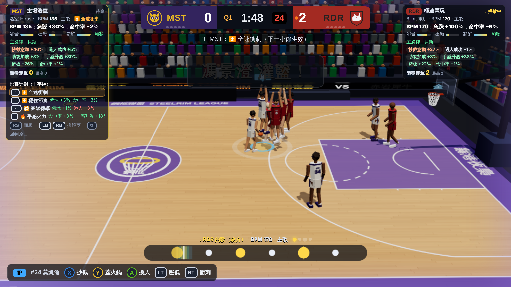
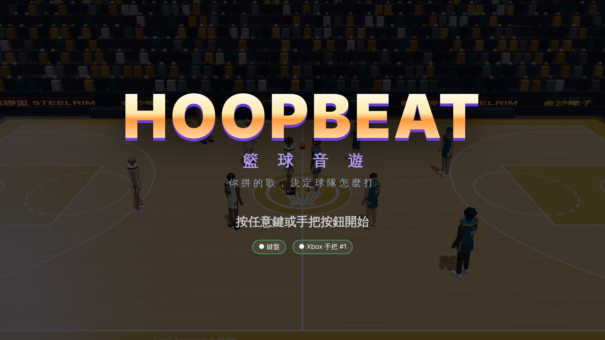
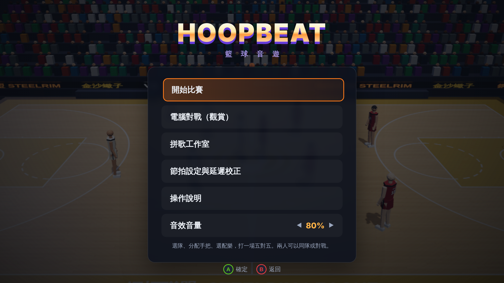
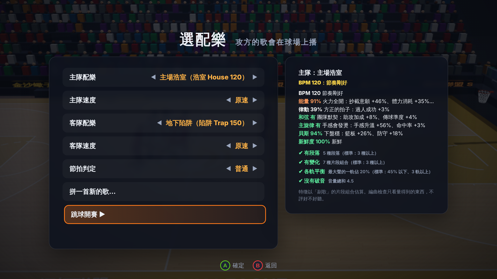
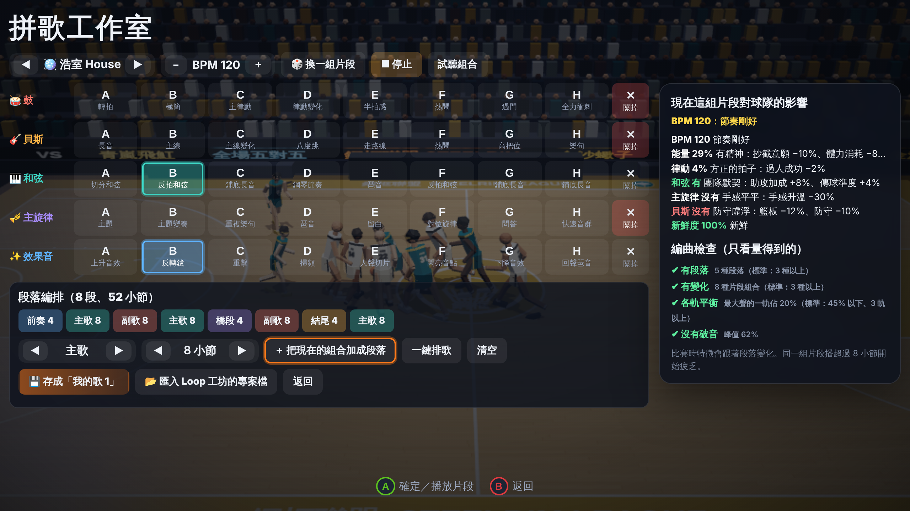
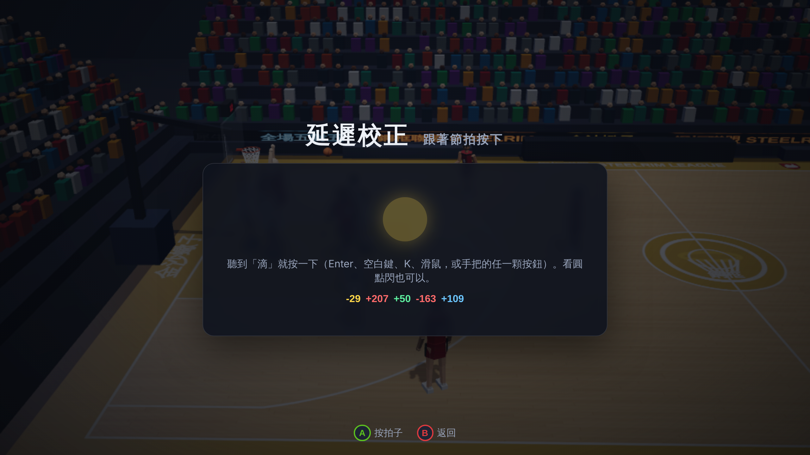
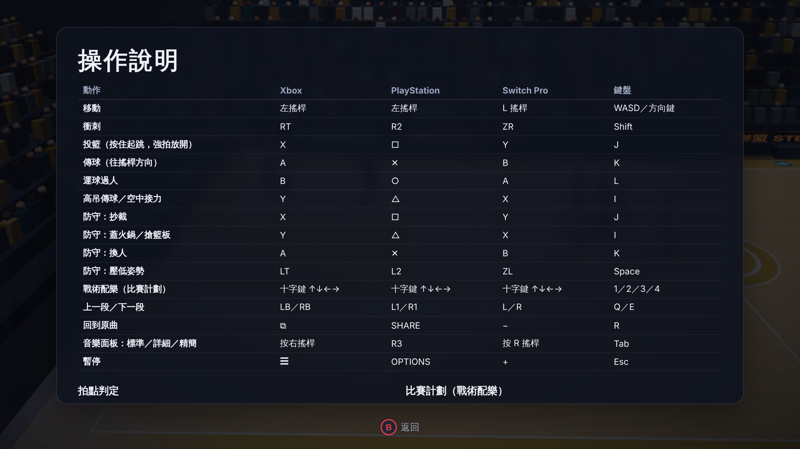
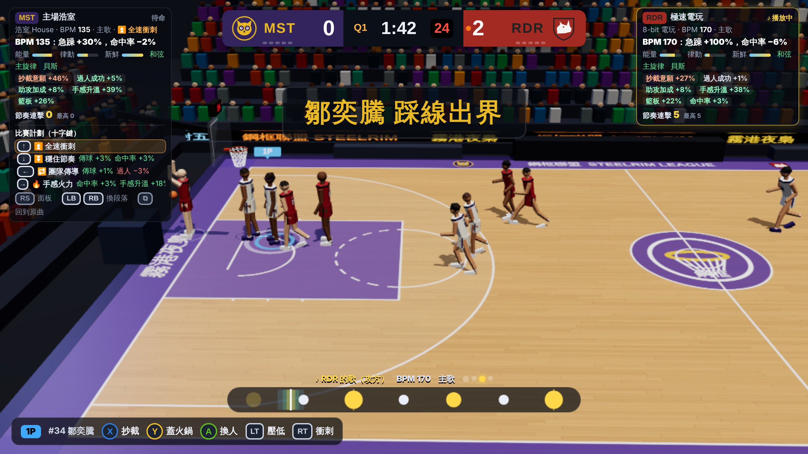
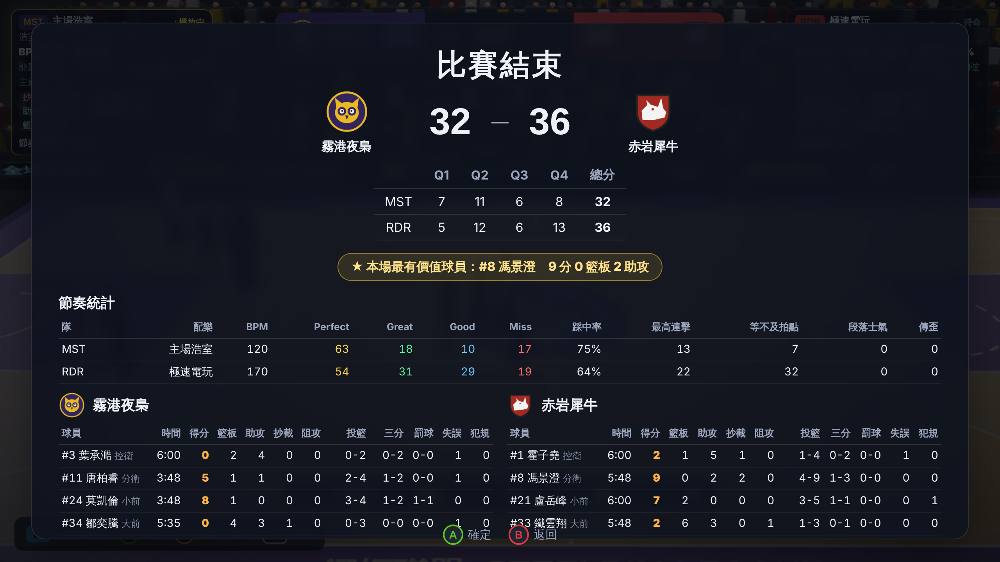

# HOOPBEAT 籃球音遊

原創的網頁 3D 五對五籃球。賽前用 loop station 拼一首歌，比賽時那首歌就是配樂。**歌的速度、能量、律動、編制會即時改變球員的表現**，而且投籃、傳球、過人、抄截、蓋火鍋都要**踩拍點**。

核心還是籃球：空檔、距離、防守干擾、跑位、擋拆照樣決定一切。音樂是疊在上面的一層。同樣兩隊換一首歌，就會打成不同的比賽。

- 球員、球隊全部是虛構的（沿用「鋼框聯盟」的隊伍）。
- 純靜態網頁，不需要打包，不從 CDN 載入任何東西。
- 支援 Xbox、PlayStation、Switch Pro 手把與鍵盤，可以兩人同隊或對戰。



## 怎麼開

在 repo 根目錄（或 `hoopbeat/` 裡）開任何靜態伺服器：

```bash
cd hoopbeat
python3 -m http.server 8000
```

再用瀏覽器打開 http://localhost:8000/ 。也可以用內附的伺服器：

```bash
node hoopbeat/tests/serve.mjs 8000
```

> 直接雙擊 `index.html`（`file://`）不行，因為瀏覽器不允許 `file://` 載入 ES 模組。

## 怎麼玩

1. **標題 → 主選單**：按任意鍵。
2. **開始比賽**：選隊 → 分配手把（往左＝主隊、往右＝客隊，兩人可以同隊）→ 比賽設定 → **選配樂**。
3. **選配樂**：每隊選一首歌（6 首示範歌，或自己在「拼歌工作室」做的歌），也可以改速度（70～180 BPM）。右邊會即時列出這首歌對球隊的影響和編曲檢查。選的時候會試聽。
4. **比賽**：球場上播的是**進攻方**的歌，換邊時在下一個小節線切換（速度也跟著換）。
5. **比賽中調整比賽計劃**：用十字鍵換「戰術配樂」、用肩鍵換段落（見下面）。
6. **賽後**：除了 hoops 原本的數據表，還有「節奏統計」：每隊的 Perfect／Great／Good／Miss、踩中率、最高連擊、等不及拍點的次數、段落士氣次數、傳歪次數。

其他入口：

- **拼歌工作室**：選曲風（6 種）、改速度、點片段即時試聽（下一個小節線切換）、把喜歡的組合存成段落、一鍵排歌，最後存成「我的歌」帶去比賽。也可以匯入 Loop 工坊（`loops/`）匯出的 `.json` 專案檔；如果兩個遊戲放在同一個網站上，Loop 工坊存在瀏覽器裡的歌也會直接出現在選歌清單（♫）。
- **節拍設定與延遲校正**：判定難度、延遲校正（可以自動測量）、節拍器、音樂音量。
- **電腦對戰（觀賞）**：兩隊電腦對打，可以觀察不同速度的歌怎麼改變打法。

## 按鍵表

| 動作 | Xbox | PlayStation | Switch Pro | 鍵盤 |
|---|---|---|---|---|
| 移動 | 左搖桿 | 左搖桿 | L 搖桿 | WASD／方向鍵 |
| 衝刺 | RT | R2 | ZR | Shift |
| 投籃（按住起跳，**強拍放開**） | X | □ | Y | J |
| 傳球（往搖桿方向） | A | ✕ | B | K |
| 運球過人 | B | ○ | A | L |
| 高吊傳球／空中接力 | Y | △ | X | I |
| 防守：抄截 | X | □ | Y | J |
| 防守：蓋火鍋／搶籃板 | Y | △ | X | I |
| 防守：換人 | A | ✕ | B | K |
| 防守：壓低姿勢 | LT | L2 | ZL | 空白鍵 |
| **戰術配樂**（比賽計劃） | 十字鍵 ↑↓←→ | 十字鍵 ↑↓←→ | 十字鍵 ↑↓←→ | 1／2／3／4 |
| **上一段／下一段** | LB／RB | L1／R1 | L／R | Q／E |
| **回到原曲** | View（⧉） | SHARE | − | R |
| 音樂面板：標準／詳細／精簡 | 按右搖桿 | R3 | 按 R 搖桿 | Tab |
| 暫停 | ☰ | OPTIONS | + | Esc |

和 hoops 原版的差別：十字鍵不再控制移動，LB／RB 不再是衝刺／壓低（改用 RT／LT），這些按鍵都讓給配樂。

選單：十字鍵或搖桿移動、A（PS ✕、Switch B）確定、B（PS ○、Switch A）返回；鍵盤用方向鍵、Enter、Esc。

## 拍點判定怎麼算

### 什麼時候判定

| 動作 | 判定的時間點 | 基準 |
|---|---|---|
| 跳投、罰球 | **放開**按鈕的瞬間 | 最近的拍點；**只有強拍**（每小節第 1、3 拍，金色）才有 Perfect，踩在弱拍上最多 Great |
| 上籃、灌籃 | 按下的瞬間 | 最近的拍點 |
| 傳球、過人、抄截、蓋火鍋 | 按下的瞬間 | 最近的拍點 |

### 判定窗口（單邊，毫秒）

以 120 BPM 為基準：

| 難度 | Perfect | Great | Good |
|---|---|---|---|
| 簡單 | ±55 | ±95 | ±150 |
| 普通 | ±42 | ±78 | ±125 |
| 困難 | ±30 | ±58 | ±95 |

**速度越快，窗口越窄**：窗口 × (120 ÷ BPM)^0.85（限制在 0.6～1.4 倍），而且 Good 窗口最多到半拍的 80%，不會和下一拍重疊。普通難度的實際窗口：

| BPM | Perfect | Great | Good | 拍與拍的間隔 |
|---|---|---|---|---|
| 80 | ±59 | ±109 | ±175 | 750 ms |
| 120 | ±42 | ±78 | ±125 | 500 ms |
| 170 | ±31 | ±58 | ±93 | 353 ms |

快歌拍點更密、窗口更窄，所以更難踩準，這是「打得急躁」的主要代價。

### 判定結果的影響

| 動作 | Perfect | Great | Good | Miss |
|---|---|---|---|---|
| 投籃（命中率倍數） | ×1.22 | ×1.06 | ×0.90 | ×0.64 |
| 傳球（偏差倍數） | ×0.5、球速 +10% | ×0.8 | ×1 | ×1.9，另外 +7% 傳歪 |
| 過人（成功率） | +25% | +14% | +4% | −15%，另外 +8% 運球失誤 |
| 抄截（成功率） | +22% | +12% | +3% | −10% |
| 蓋火鍋（成功率） | +22% | +12% | +3% | −10% |

這些都是**加成**，不取代籃球判斷：命中率還是先由出手距離、防守干擾、球員能力值決定。

### 節奏連擊

Perfect／Great／Good 都會讓全隊的連擊 +1，Miss 歸零。連擊越高手感越好，16 下以上滿：命中率 +8%、傳球 +4%、過人 +5%。

### 延遲校正

判定前會先扣掉「延遲校正」的毫秒數。正值＝你的按鍵被記錄得比較晚（藍牙耳機很常見）。

- 遊戲用 `AudioContext.getOutputTimestamp()` 換算「耳朵現在聽到的是哪個時間點」，瀏覽器回報的輸出延遲會自動扣掉。
- 鍵盤用按鍵事件本身的時間（`KeyboardEvent.timeStamp`），不是下一幀才讀；手把每一幀讀一次。
- 剩下的誤差（耳機、螢幕、手把）用「節拍設定 → 自動測量延遲」：跟著 100 BPM 的節拍按 12 下，取偏移的中位數（去掉前兩下）。也可以手動用 ←／→ 每次調 5 毫秒。

### 畫面上怎麼看拍子（不看數字也抓得到）

- **腳下的節拍圈**：控制中的球員腳下有一圈往內收縮，縮到最小的瞬間就是拍點。強拍是金色，判定後會閃對應的顏色。
- **全畫面的邊框**跟著拍子亮一下，強拍比較亮；主隊的歌是金色、客隊的歌是紫色。
- **底部的拍點軌道**：點往左移到白線就是拍點，大的金點是強拍；白線兩側的色帶就是 Perfect／Great／Good 窗口（速度變快時色帶會變窄）。你最近幾次按的位置會畫在軌道上，看得出是偏早還是偏晚。
- **判定字**：Perfect／Great／Good／Miss 浮在球員頭上，不是 Perfect 時還會寫「早 23ms」「晚 40ms」。
- 可以在設定裡打開節拍器聲音。

### 電腦球員怎麼踩拍子

電腦決定要傳球、過人、抄截、投籃之後，會等到下一個拍點才出手（跳投會往回推算起跳時間，讓出手落在強拍上），誤差是常態分布（普通難度 σ = 42 ms）。越急躁的歌，越常「等不及拍點」直接出手（機率 5% + 25% × 急躁程度）。蓋火鍋要配合對手出手，沒辦法等拍點，照實際時間判定。

## 比賽計劃（戰術配樂）

比賽中隨時可以換，改動在**下一個小節線**生效（跟 loop station 一樣）。自己隊伍的歌沒在播時，改動會立刻生效，換你進攻時就會聽到。

| 按鍵 | 戰術 | 怎麼改音樂 | 主要 buff | 主要 debuff |
|---|---|---|---|---|
| ↑／1 | ⏫ 全速衝刺 | 加快 15 BPM，鼓和貝斯換最熱鬧的片段 | 跑速、抄截意願、防守壓迫 | 判定窗口變窄、命中率、失誤、犯規 |
| ↓／2 | ⏬ 穩住節奏 | 放慢 15 BPM，鼓變輕、貝斯拉長音 | 傳球、助攻、命中率、判定窗口變寬 | 跑速、抄截意願、轉換慢 |
| ←／3 | 🔁 團隊傳導 | 開和弦、走路貝斯、搖擺的鼓 | 傳球、助攻、過人 | 關掉主旋律：手感升溫變慢 |
| →／4 | 🔥 手感火力 | 開主旋律的主題樂句 | 命中率、手感升溫 | — |
| LB／RB、Q／E | 上一段／下一段 | 跳到歌的上一段／下一段（戰術保留） | 依段落而定 | — |
| View、R | 回到原曲 | 取消所有切換，速度回到賽前設定 | — | — |

- 面板上的「比賽計劃」卡片會**預告**每個戰術跟現在比會怎麼變（例如「全速衝刺：跑速 +16%、判定窗口 −19%」），這些數字和實際套用的一樣，都是從同一份規則算出來的。
- **士氣**：在樂句開頭（每 4 小節）手動換片段，而且距離上次換至少 4 小節，全隊會有 8 秒的士氣加成（命中率 +5%、跑速 +5%、防守 +8%，逐漸消退）。歌曲自己換段不算。
- **疲乏**：同一組片段播超過 8 小節開始疲乏，32 小節後完全疲乏（命中率 −7%、失誤 +5%、防守 −15%、跑速 −5%）。換片段或換段落就會恢復。
- 電腦隊伍也會當 DJ：聽膩了（新鮮度低於 75%）會在樂句交界換到下一段。

## 音樂怎麼影響球員（對照表）

特徵直接從 loop station 的資料算（每個片段的音符、生成器標的能量、目前在播哪些軌、音量），不分析音訊。所有加成都會顯示在比賽畫面兩側的面板上。

| 特徵 | 怎麼算 | 影響 |
|---|---|---|
| **速度（BPM）** | 急躁 = (BPM − 120) ÷ 50，上限 1；沉穩是反過來 | **快**：跑速 +22%（170 BPM）、出手前等待 −50%、選擇投籃變差、命中率 −6%、失誤 +5%、犯規 +90%、抄截意願 +25%、防守壓迫 +12%、體力消耗 +30%，加上判定窗口變窄。<br>**慢**（主打傳導）：跑速 −18%（80 BPM）、出手前等待 +36%、選擇投籃變好、命中率 +3%、傳球準度 +5%、助攻加成 +6%、犯規 −16%、抄截意願 −24%，判定窗口變寬 |
| **能量** | 30% × 在播軌數 ÷ 5 + 40% × 鼓的密度 + 30% × 片段能量 | 以 40% 為基準：越高體力消耗越多、侵略性越高、抄截意願越高（能量 90% 時：體力 +35%、抄截意願 +45%） |
| **律動** | 50% × 搖擺程度 + 50% × 切分音比例（大鼓、小鼓、貝斯不在四分音符上的比例）；沒有鼓打 4 折 | 過人成功率 −3%～+13% |
| **和弦（鋪底）** | 和弦軌的音量 | 有：傳球準度 +4%、助攻加成 +8%；沒有：傳球 −2% |
| **主旋律** | 主旋律軌的音量 × 音符密度 | 有：命中率 +4%、手感升溫最多 +70%；沒有：手感升溫 −30% |
| **貝斯** | 貝斯軌的音量 × 片段能量 | 有：防守、籃板最多 +20% 和 +28%；沒有：防守 −10%、籃板 −12% |
| **新鮮度（變化度）** | 同一組片段連續播了幾個小節 | 見上面的「疲乏」 |
| **節奏連擊** | 見上面 | 命中率最多 +8% |
| **手感發燙** | 進球 +0.42 × 手感升溫倍數、沒進 −0.3，慢慢退燒 | 每位球員最多命中率 +9% |

- 命中率、失誤率、傳球、過人、助攻加成是**百分點**加減；跑速、犯規、體力消耗、防守、籃板、抄截意願是**倍數**。
- 沒有任何音樂時：跑速 −10%、命中率 −4%、防守 −10%。

### 編曲檢查（不主觀打「好不好聽」的分數）

只看量得到的東西，在選歌和拼歌工作室裡照實顯示：

| 檢查 | 量什麼 | 標準 |
|---|---|---|
| 有段落 | 段落類型（前奏、主歌、副歌、橋段、結尾）有幾種 | 3 種以上 |
| 有變化 | 不同的片段組合有幾種 | 3 種以上 |
| 各軌平衡 | 有用到的軌裡，最大聲的一軌佔總音量多少 | 45% 以下，而且 3 軌以上 |
| 沒有破音 | 播放時量輸出峰值（沒播時用音量總和估算） | 峰值低於 85%（限幅器的天花板是 86%） |

## BPM 實驗結果

同樣的兩隊（霧港夜梟 vs 赤岩犀牛）、同一首歌（浩室，種子 `exp`），只改速度。電腦對電腦、無畫面加速跑，每種速度 12 場、每節 3 分鐘，數字是**每隊每場**的平均：

| BPM | 得分 | 出手數 | 命中率 | 失誤 | 犯規 | 抄截 | 助攻 | 拍點 Perfect | 拍點 Miss | 等不及拍點 |
|---|---|---|---|---|---|---|---|---|---|---|
| 80 | 44.8 | 31.9 | **55.8%** | 4.8 | 1.9 | 4.0 | 15.5 | 74.1% | 6.3% | 5.0% |
| 120 | 49.0 | 37.6 | 50.7% | 5.1 | 3.3 | 4.6 | 16.1 | 61.4% | 6.7% | 4.3% |
| 170 | 47.1 | **40.7** | 41.5% | **9.8** | **6.0** | 7.1 | 13.4 | 41.9% | 18.4% | 26.7% |

方向和設計一致：

- BPM 越快 → **出手越多**（31.9 → 40.7）、**命中率越低**（55.8% → 41.5%）、**失誤越多**（4.8 → 9.8）、**犯規越多**（1.9 → 6.0）、抄截越多。
- 快歌的拍點最難踩：Perfect 從 74% 掉到 42%，Miss 從 6% 升到 18%，「等不及拍點」從 5% 升到 27%。
- 慢歌命中率最高、出手最少，助攻佔進球的比例最高。

重跑：`node hoopbeat/tests/sim/bpm-experiment.mjs 12 3`

### 快慢歌相剋（不同速度對戰）

| 對戰（各 12 場，主客場互換） | 結果 |
|---|---|
| 170 vs 80 | 170 贏 7 場：全場壓迫的抄截（7.8 次）打爆慢慢傳導的隊伍（失誤 8.6 次） |
| 80 vs 120 | 80 贏 7 場：傳導找到好球（命中率 56.5%） |
| 170 vs 120 | 170 贏 2 場：快歌命中率太低、犯規太多 |

沒有一種速度一定贏，所以要看對手的歌來調自己的比賽計劃。重跑：`node hoopbeat/tests/sim/matchup.mjs 170 80 12`

## 測試

```bash
cd hoopbeat
npm test                              # 單元測試（node --test）
node tests/sim/bpm-experiment.mjs 12 3 # BPM 實驗
node tests/sim/matchup.mjs 170 120 12  # 不同速度對戰
node tests/e2e/gamepad.mjs screenshots # Playwright：模擬手把從標題一路玩到比賽
node tests/e2e/keyboard.mjs           # Playwright：鍵盤在拍點上按，確認用的是精確的按鍵時間
node tests/e2e/screens.mjs screenshots # Playwright：各畫面截圖
```

- **拍點判定**（`tests/unit/judge.test.js`）：拍點前後不同毫秒數的判定、早晚符號、延遲校正、難度、速度越快窗口越窄、窗口不重疊、投籃的強拍規則、自動測延遲、連擊。
- **特徵與對應規則**（`tests/unit/music.test.js`）：能量、律動、靜音、疲乏、BPM 的方向、各特徵的方向、連擊與士氣、說明文字和實際數值一致、編曲檢查。
- **配樂台與指揮**（`tests/unit/deck.test.js`）：照編排播放、小節線切換、疲乏與士氣、BPM 覆寫、換邊時切速度。
- **整合**（`tests/unit/bridge.test.js`）：真人按在拍點上是 Perfect、延遲校正在比賽中生效、電腦把動作排到拍點上、播進攻方的歌、修正值套到球員、戰術配樂的預告方向。
- **Playwright**：頁面載入 console 沒有錯誤；注入假的 Xbox 手把，從標題、選單、選隊、手把分配、設定、選歌一路操作到開賽，比賽中跟著拍點按鍵、用十字鍵換戰術，檢查判定有記錄、console 沒有錯誤。

> 無頭瀏覽器用軟體算繪 3D，大約只有 5 FPS，手把測試在操作時會暫時關掉算繪（遊戲邏輯照跑），截圖時再打開。

## 截圖

| | |
|---|---|
|  |  |
|  |  |
|  |  |
|  |  |
|  | |

## 檔案結構

```
hoopbeat/
  index.html              進入點（import map 指向 vendor/three）
  src/
    main.js, app.js       HoopbeatApp：繼承 hoops 的 App，加上配樂、拍點、HUD、選歌
    rhythm/               拍點格線（beatgrid）、判定與連擊（judge）
    music/                特徵（features）、對應規則（effects）、編曲檢查（quality）、
                          配樂台（deck）、指揮（conductor）、戰術配樂（tactics）、示範歌、歌曲庫
    game/beatbridge.js    拍點橋接：包住 hoops 的投籃／傳球／過人／抄截／蓋火鍋，套音樂修正值
    audio/stage.js        音訊：每隊一組 loops 混音台，播進攻方的歌；按鍵時間換算成「聽到的時間」
    ui/                   節拍 HUD、3D 節拍圈、選單畫面、拼歌工作室
    hoops/                複製自 hoops（見 SOURCE_COMMIT），修改處都標了 HOOPBEAT
    loops/                複製自 loops（見 SOURCE_COMMIT），沒有修改
    hoopbeat.css
  vendor/                 three.js（複製自 hoops，MIT 授權）
  tests/                  unit／sim／e2e
  tools/sync-upstream.sh  把 hoops／loops 的新版合併進來（三方合併）
  screenshots/
```

### 怎麼跟 hoops、loops 整合

- `src/hoops/` 是 hoops 的原始碼，只在少數地方插了掛勾（`grep -rn HOOPBEAT src/hoops` 可以看全部），例如命中率加上 `this.beat.shotBonus()`、跑速乘上 `mods.speed`、電腦的出手門檻加上音樂的選擇投籃修正。
- `src/loops/` 是 loops 的音樂模組（生成器、合成器、混音台、播放器），完全沒改。
- `tools/sync-upstream.sh <hoops commit> <loops commit>`：hoops 用 `git merge-file` 做三方合併（保留 HOOPBEAT 的修改），loops 直接覆蓋。

## 已知的限制

- 投籃條：hoops 原本的投籃時機條先關掉了，改用腳下的節拍圈和底部的拍點軌道。之後會把投籃條改成「往強拍填滿、綠區＝Perfect 窗口」（快歌填得更快、綠區更窄）。
- 鍵盤用按鍵事件的精確時間判定；手把只能每一幀讀一次（Gamepad API 沒有逐鍵時間），60 FPS 時最多差約 16 毫秒。
- 兩人對戰時，球場上一次只播一首（進攻方的歌）；防守方的歌沒在播，但它的特徵照樣影響防守方。
- 電腦的節奏感是統計模型（常態分布的誤差 + 急躁時等不及拍點），不是真的「聽」音樂。
- 編曲檢查的「破音」在沒播放時只能用音量估算。
- 「好不好聽」沒有評分，只有量得到的檢查。
- 無頭瀏覽器的 3D 算繪很慢，自動化測試只能用低 FPS 驗證；實際遊玩請用有 GPU 的瀏覽器。
