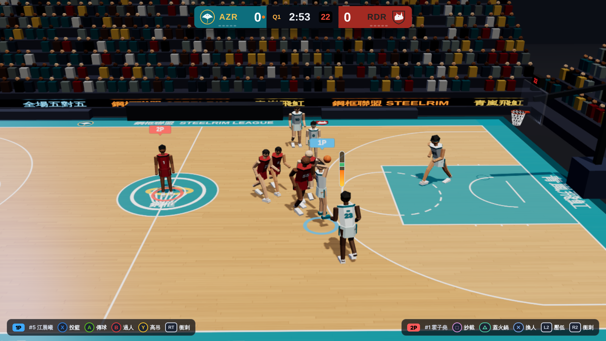

# 鋼框 STEELRIM｜五對五全場籃球

一款在瀏覽器裡玩的原創 3D 籃球遊戲。五對五全場，可以接 Xbox、PlayStation、Switch Pro 手把，也可以用鍵盤。

遊戲名稱、聯盟（鋼框聯盟）、6 支球隊、48 位球員、隊徽與介面都是原創設計。與任何真實球員、球隊、聯盟或現有遊戲無關。



## 怎麼開

遊戲是純靜態檔案，不需要安裝或打包。

1. 在 `hoops/` 資料夾開一個靜態伺服器：

   ```bash
   cd hoops
   python3 -m http.server
   ```

2. 用 Chrome 打開 http://localhost:8000 。
3. 插上手把（可以隨時插拔），在標題畫面按任意鍵開始。

注意：一定要透過伺服器開。直接雙擊 `index.html`（`file://`）時，瀏覽器會擋 ES 模組，遊戲不會啟動。

所有路徑都是相對路徑，整個 `hoops/` 資料夾可以直接放到任何靜態網站空間（例如 GitHub Pages 的子目錄）。

手把需要「安全來源」：`localhost` 或 HTTPS 網址都可以。用區域網路 IP（例如 `http://192.168.x.x`）開時，Chrome 會關掉 Gamepad API，只能用鍵盤。

## 遊戲流程

1. **標題畫面**：背景是兩隊電腦在打的示範賽。
2. **主選單**：開始比賽、電腦對戰（觀賞）、操作說明、音量。
3. **選擇球隊**：選主隊與客隊。卡片顯示隊徽、整體／進攻／防守／運動評價，以及 8 位球員的背號、位置、身高、綜合評價。
4. **手把分配**：每個裝置用自己的方向鍵往左（主隊）、中間（電腦）、往右（客隊）移動。
   - 1P 對 2P：一個去主隊、一個去客隊。
   - 2 人同隊打電腦：兩個都移到同一邊。
   - 沒有人加入：變成電腦對戰觀賞。
5. **比賽設定**：難度（簡單／普通／困難）、每節長度（2–12 分鐘，預設 3 分鐘，共 4 節）、自動換人、鏡頭遠近。
6. **比賽**：第一節跳球開賽。按 Start／Options／+／Esc 暫停。
7. **每節結束**：顯示比分與各節得分。中場休息後雙方交換場地。
8. **比賽結束**：每位球員的上場時間、得分、籃板、助攻、抄截、阻攻、投籃、三分、罰球、失誤、犯規，以及本場最有價值球員。

## 按鍵表

遊戲用 Gamepad API 的 standard mapping。手把按鍵以「位置」對應動作，所以不同手把的字母不一樣，但手指的位置一樣。畫面上的提示會自動換成你那支手把的符號。

### 進攻（持球）

| 動作 | Xbox | PlayStation | Switch Pro | 鍵盤 |
|---|---|---|---|---|
| 移動 | 左搖桿／十字鍵 | 左搖桿／十字鍵 | 左搖桿／十字鍵 | W A S D 或方向鍵 |
| 衝刺 | RT（或 RB） | R2（或 R1） | ZR（或 R） | Shift |
| 投籃：按住起跳，最高點放開 | X | □ | Y | J |
| 傳球：往搖桿方向傳給最近的隊友 | A | ✕ | B | K |
| 運球過人（胯下、轉身） | B | ○ | A | L |
| 高吊傳球／空中接力 | Y | △ | X | I |

### 防守

| 動作 | Xbox | PlayStation | Switch Pro | 鍵盤 |
|---|---|---|---|---|
| 移動 | 左搖桿 | 左搖桿 | 左搖桿 | W A S D 或方向鍵 |
| 壓低防守姿勢（比較慢，干擾比較強） | LT（或 LB） | L2（或 L1） | ZL（或 L） | Space |
| 抄截（失敗可能犯規） | X | □ | Y | J |
| 跳起蓋火鍋／搶籃板 | Y | △ | X | I |
| 切換到離球最近的球員 | A | ✕ | B | K |
| 衝刺 | RT | R2 | ZR | Shift |

### 其他

| 動作 | Xbox | PlayStation | Switch Pro | 鍵盤 |
|---|---|---|---|---|
| 暫停選單 | ☰（Menu） | OPTIONS | + | Esc 或 P |
| 無球時要球 | A | ✕ | B | K |
| 無球時要求空中接力 | Y | △ | X | I |
| 跳球時起跳 | Y | △ | X | I |
| 罰球：按住、在綠色區放開 | X | □ | Y | J |
| 選單確定／返回 | A／B | ✕／○ | B／A | Enter／Esc |

選單也可以用滑鼠點。

### 小技巧

- 投籃時球員旁邊會出現時機條。在綠色區放開是「完美出手」，命中率最高。太早或太晚命中率會下降。
- 靠近籃框並往籃框跑時按投籃，會自動上籃；運動能力好的球員會灌籃。
- 隊友往籃下切入時按高吊，會傳空中接力。
- 防守時從背後抄，或離太遠亂抄，比較容易被吹犯規。
- 單節團隊犯規第 5 次起，對手直接罰兩球。

## 規則

- 比賽時鐘：每節 2–12 分鐘可調，預設 3 分鐘、共 4 節。平手打延長賽（每節長度的一半，至少 1 分鐘）。
- 24 秒進攻時限：換球權重設 24 秒；投籃碰框後的進攻籃板補到 14 秒；比賽剩餘時間少於 24 秒時關閉。
- 兩分與三分：三分線弧頂 6.75 公尺、底角 6.6 公尺。
- 投進後由對手在底線發球。第四節與延長賽最後 2 分鐘投進會停錶。
- 出界：球碰到界外地板，或持球者踩出邊線、底線，由對方發邊線球。
- 犯規：投籃犯規罰 2 或 3 球，進球加罰 1 球。抄截犯規在團隊犯規 5 次前發邊線球，第 5 次起罰 2 球。
- 跳球與交替球權：第一節跳球；第二、三節由跳球輸的一方發球，第四節由跳球贏的一方發球。
- 比分板顯示比分、節數、比賽時間、進攻時限、團隊犯規、加罰狀態與球權。籃板上方也有進攻計時器。

## 電腦 AI

- **進攻**：依位置站到拉開空間的點（弧頂、兩翼、底角、低位），持球者會讓位；空手球員在防守者放鬆時往籃下切；大個子會上來做擋拆，擋完往籃下順下；搶到籃板後有快攻，跑三條快攻路線。
- **出手判斷**：依能力值、距離、有沒有空檔、進攻時限計算期望得分，決定投、傳或切入。快沒時間時會強投。
- **防守**：人盯人，持球者的防守距離依對手的速度與投籃能力調整；離球越遠的防守者越往禁區縮；被突破時最近的隊友會協防；被擋拆卡住時會換防；出手時會補防、起跳封阻；投籃時會卡位搶籃板。
- **難度**：影響電腦的反應時間、能力值倍率、出手選擇、抄截頻率、協防頻率、阻攻與攔截傳球能力，以及你投籃時機的寬容度。

## 能力值怎麼影響結果

| 能力值 | 影響 |
|---|---|
| 三分 | 三分命中率、罰球、電腦是否願意投三分 |
| 中距離 | 中距離與罰球命中率 |
| 籃下 | 上籃、灌籃命中率、空中接力成功率、灌籃距離 |
| 速度 | 最高速度、加速度、跳躍、灌籃距離 |
| 控球 | 持球移動速度、被抄截機率、過人成功率、傳球準度與速度 |
| 防守 | 干擾投籃、抄截、攔截傳球、跟防反應速度、犯規機率 |
| 籃板 | 搶籃板範圍與權重、跳球 |
| 阻攻 | 封阻機率、起跳高度 |
| 身高 | 模型大小、摸高、干擾、封阻、籃板、出手點高度 |

## 球隊

| 球隊 | 代號 | 風格 |
|---|---|---|
| 霧港夜梟 | MST | 外線火力 |
| 赤岩犀牛 | RDR | 禁區肉搏 |
| 青嵐飛魟 | AZR | 快攻轉換 |
| 北嶺雪豹 | NRS | 鐵血防守 |
| 金沙蠍子 | GSS | 全能球星 |
| 翠林樹蛙 | JWT | 彈跳運動 |

每隊 8 人：先發 5 人加 3 位替補。開啟「自動換人」時，體力下降的球員會在死球時被換下。

## 測試

需要 Node.js 18 以上。端對端測試另外需要 Playwright 與 Chromium。

1. 規則與模擬單元測試（計分、進攻時限、球權轉換、換節、犯規、投籃物理、整場比賽）：

   ```bash
   node --test hoops/tests/unit/*.test.mjs
   ```

2. 端對端測試（Playwright 無頭瀏覽器，會自己開靜態伺服器）：

   ```bash
   node hoops/tests/e2e/e2e.cjs
   ```

   內容：
   - 頁面載入時 console 沒有錯誤。
   - 模擬 `navigator.getGamepads`：用手把走完選單、移動、傳球、投籃、抄截、換人、2P 起跳；檢查 Xbox 顯示字母、PS 顯示符號；比賽中拔掉手把會自動暫停；插上 Switch Pro 手把可以辨識。
   - 電腦對電腦加速跑完 3 場完整比賽：檢查分數有增加、位置沒有 NaN、球沒有卡住、進攻時限會重設、球員得分總和等於比分。
   - 在 13 個不同時刻截圖，存到 `hoops/screenshots/`。

   可以只跑其中一部分，例如 `--only ai --games 5`。

   最近一次結果（2026-11-04，無頭 Chromium + SwiftShader）：**19/19 通過**。

   | 項目 | 結果 |
   |---|---|
   | 載入時 console 錯誤 | 0 |
   | 手把類型辨識 | Xbox、PlayStation、Switch Pro 都正確 |
   | 手把操作 | 選單、移動、傳球、投籃、抄截、換人、2P 起跳都有反應 |
   | 電腦對電腦 3 場（每節 2 分鐘） | 比分 30:35、22:28、39:27；NaN 0；最長無人持球 3.1 秒；進攻時限重設 37–48 次／場 |
   | 截圖 | 13 張，都看過 |

   單元測試：**28/28 通過**（規則 18 項、模擬 5 項、玩家操控 5 項）。

3. 數值平衡工具（在 Node 裡跑無畫面比賽並印出數據）：

   ```bash
   node hoops/tests/tools/simulate.mjs 12 3
   ```

## 檔案結構

```
hoops/
  index.html          進入點
  src/
    main.js, app.js   主程式、畫面流程、主迴圈
    sim/              模擬（不依賴畫面）：規則、球、球員、投籃、AI、玩家操控
    render/           Three.js 場景、球員模型與動畫、貼圖、隊徽
    input/            手把與鍵盤
    audio/            Web Audio 合成音效
    ui/               選單、HUD、按鍵符號
    data/teams.js     球隊與球員
    style.css
  vendor/             Three.js r180（MIT 授權，見 THREE_LICENSE.txt）
  tests/              單元測試、端對端測試、平衡工具
  screenshots/        測試截圖
```

所有音效都用 Web Audio 即時合成，沒有任何外部素材。所有貼圖（球場、球衣號碼、隊徽、看板）都用 Canvas 產生。不從 CDN 載入任何東西。

## 已知的限制

- **沒有實機效能數據**：開發環境只有軟體繪圖（SwiftShader），沒辦法在 Mac mini M4 上實測 60fps。實測的負載很低：每幀約 270 次 draw call、約 3.3 萬個三角形、每步模擬約 0.06 毫秒。遊戲內建自動畫質：連續掉幀時會降低解析度。
- **沒有實體手把測試**：手把測試用模擬的 Gamepad API。非 standard mapping 的手把（部分第三方手把、某些瀏覽器上的 Switch Pro）按鍵位置可能不對。
- **聲音要先按一下**：瀏覽器規定要先有使用者操作才能播放聲音。部分瀏覽器不把手把按鍵當成使用者操作，這時請先按一下鍵盤或滑鼠。
- **震動**：只在支援 `vibrationActuator` 的瀏覽器有效。
- **沒有的規則**：回場違例、3 秒、5 秒、8 秒違例、走步、兩次運球、進攻犯規（帶球撞人）、技術犯規、暫停、犯滿畢業。蓋火鍋只能在球上升時發生，所以沒有干擾球判定。
- **換人只有自動**：不能手動選擇上場陣容。
- **物理簡化**：球不會打到球員身體（只會被接住、抄走或撿起）；籃網只是視覺效果。
- **玩家人數**：最多 2 支手把加鍵盤，每隊最多 2 位玩家。
- **鍵盤只能一人用**：兩個人要對打時請至少接一支手把。
- **手機與觸控**：沒有觸控操作。
