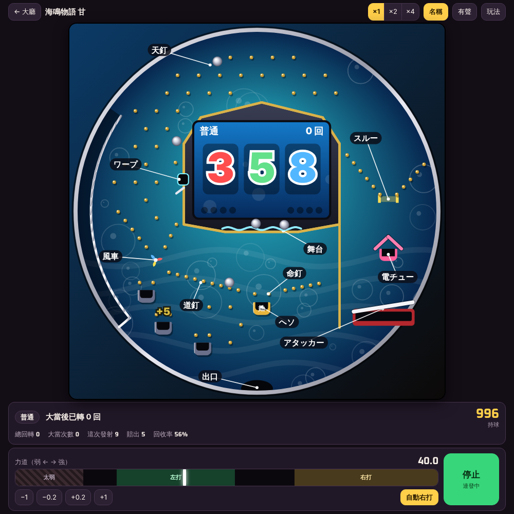

# 鋼珠會館

照日本真機的盤面做的小鋼珠遊戲。有 4 台機台，3 種機型。純遊戲，鋼珠不能換錢。

- 純靜態網頁：不需要安裝、不需要打包。
- 所有圖都用程式畫，所有聲音都用 Web Audio API 即時合成。
- 手機直向、桌機橫向都能玩。



## 怎麼開

1. 進到 `pachinko/` 資料夾。
2. 啟動靜態伺服器：

   ```bash
   node tools/serve.mjs 8080
   ```

3. 用瀏覽器打開 `http://localhost:8080/`。

`dist/pachinko.html` 是打包成一個檔案的版本。直接雙擊就能玩。

改過程式之後要重新產生：

```bash
npm i --no-save esbuild
```

```bash
node tools/build-single.mjs
```

## 怎麼玩

真機的玩法只有一個動作：轉把手決定力道。這裡也一樣。

1. 拖曳「力道」。力道決定鋼珠飛多遠。
2. 按「發射」。鋼珠開始連發，一分鐘 100 顆（真機的上限）。
3. 看鋼珠落在哪裡，再微調力道。

| 力道 | 鋼珠去哪裡 |
|---|---|
| 太弱（斜線區） | 飛不出發射軌道，掉回來。這叫界外球，會退回，不扣球。 |
| 左打（綠色區） | 落在盤面左邊和中間。平常都用這個力道。 |
| 右打（黃色區，只有數位機） | 沿著外軌繞到右邊。大當和確變時才用。 |

| 操作 | 鍵盤 |
|---|---|
| 調力道 | ← →（按住 Shift 微調） |
| 發射／停止 | 空白鍵 |
| 回大廳 | Esc |

畫面上方的「名稱」按鈕會標出盤面各部位的名字。「×1 ×2 ×4」調遊戲速度。

## 機台

| 機台 | 機型 | 怎麼中獎 | 綠色區力道的回收率 |
|---|---|---|---|
| 昭和鬱金香 | 普通機（チューリップ台） | 鋼珠進任何入賞口就賠 4 顆。鬱金香張開時更容易進。 | 約 90–140% |
| 飛燕羽根 | 羽根物（ハネモノ） | 進落とし → 羽根張開 → 鋼珠進役物 → 掉進 V 區就大當。 | 約 90–160% |
| 海鳴物語 甘 | 數位機・甘デジ（1/99.9） | 進ヘソ → 螢幕數字轉一次 → 三個一樣就大當。 | 約 115%（力道 40） |
| 龍神傳 319 | 數位機・ミドル（1/319.7） | 同上。難中，但連莊多。 | 約 120–130%（力道 40） |

回收率 = 賠出的鋼珠 ÷ 發射的鋼珠。力道不對時回收率掉到 30–70%。

### 盤面各部位（數位機）

| 名稱 | 作用 |
|---|---|
| 天釘 | 最上面的釘子。鋼珠從左上進來先撞這裡。 |
| ワープ | 螢幕左邊的洞。滾進去的鋼珠直接到舞台。 |
| 舞台（ステージ） | 螢幕下面的波浪台。從正中間掉下來幾乎一定進ヘソ。 |
| 風車 | 把鋼珠撥向左或右。往右就上道釘。 |
| 道釘 | 一排斜的釘子。鋼珠在上面滾向ヘソ。 |
| 命釘 | ヘソ正上方的兩根釘子。鋼珠要從中間掉下去。 |
| ヘソ（啟動口） | 進一顆賠 3 顆，螢幕數字轉一次。最多保留 4 次。 |
| スルー | 右邊的通過口。確變時鋼珠通過，電チュー就會開。 |
| 電チュー | 確變時一直開。進一顆賠 1 顆，數字轉一次。 |
| アタッカー（大入賞口） | 大當時打開。進一顆賠 10 顆以上。 |

### 數位機的流程

1. 左打，讓鋼珠進ヘソ。
2. 三個數字一樣：大當。力道轉到右打。
3. 大當：アタッカー打開。一回合進滿指定顆數就關，共 4 或 10 回合。7 或 3 是 10 回合。
4. 大當後進入確變。繼續右打，鋼珠進電チュー，大當機率變高。
5. 確變的回數用完：回到普通。力道改回左打。

「自動右打」開著時，第 2 步和第 5 步的力道會自動切換。關掉就要自己拉。

## 程式結構

| 檔案 | 內容 |
|---|---|
| `src/physics.js` | 物理：外軌、發射軌道、釘子、牆、風車、感應區、舞台。步長 1/120 秒。 |
| `src/machines/common.js` | 盤面的積木：釘子、入賞口、鬱金香、道釘、釘林。 |
| `src/machines/tulip.js`、`hane.js`、`digi.js` | 各機型的盤面和規則。數位機用一組參數產生兩台。 |
| `src/session.js` | 一次遊玩：盤面 + 物理 + 規則 + 統計。畫面和模擬工具共用。 |
| `src/render.js` | 畫盤面、螢幕、役物。 |
| `src/main.js` | 大廳和遊玩畫面。 |

單位是公釐。盤面 400×400，鋼珠直徑 11（和真機一樣）。重力比真機小，鋼珠掉得比較慢，看得清楚。鋼珠之間不互相碰撞。

## 測試和調整工具

```bash
npm test
```

測試內容：每台機台在建議力道下不卡球、不界外、會中獎；回收率在範圍內；大當和確變的流程會跑完。

```bash
node tools/sim.mjs ama 3000 0.2 0.6 0.05
```

固定力道連發，印出每個力道的回收率和各入口的進球率。參數：機台 id（`tulip`、`hane`、`ama`、`mid`）、每個力道幾顆、力道起點、終點、間隔。

```bash
node tools/long.mjs ama 0.4 300000
```

長時間模擬，會自動右打。用來確認數位機的實際回收率。

```bash
node tools/tune-digi.mjs life=7.3 michiEnd=181
```

改數位機的釘子參數，看ヘソ和ワープ的進球率怎麼變。
