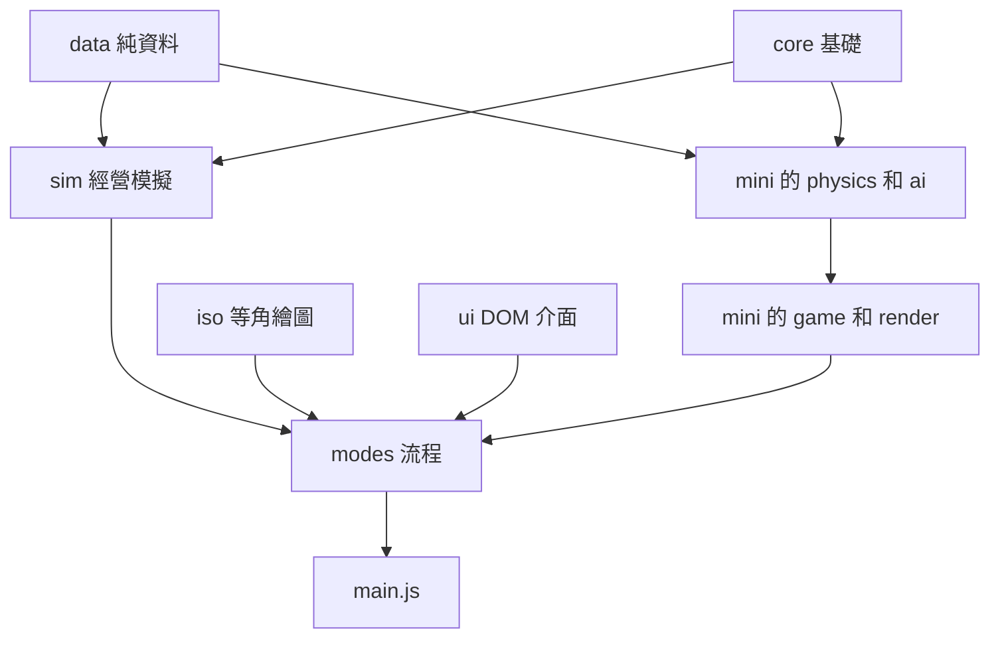
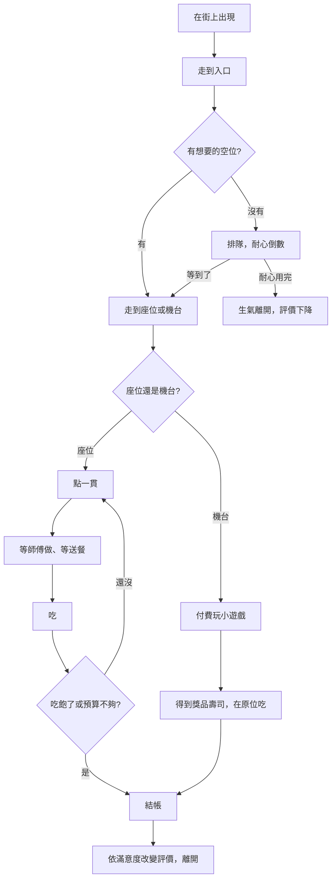
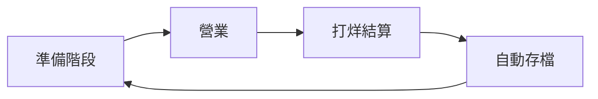
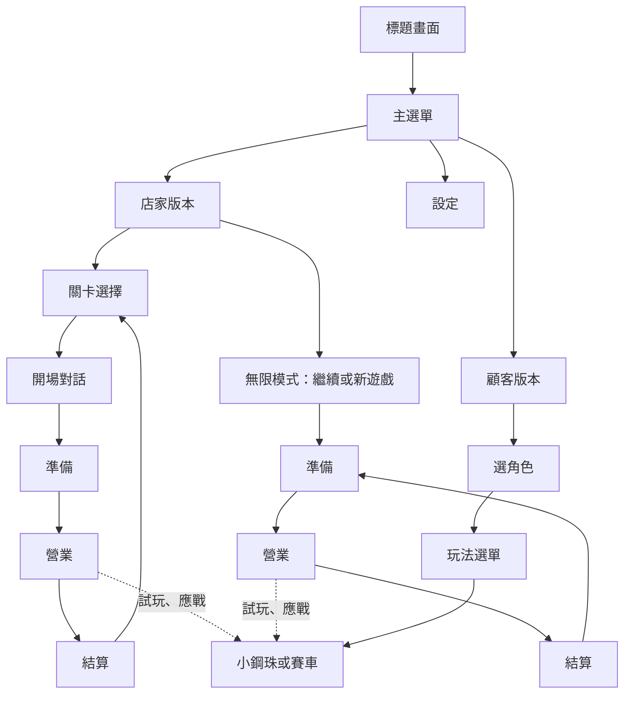

# 超神田壽司 真工夫對決 — 製作計劃書

這份文件是給執行模型（預定為 Opus）的完整規格。
執行模型沒有參與需求討論。它需要的背景都寫在這裡。

- 遊戲資料夾：`sushi/`（跟 `hoops/`、`loops/`、`hoopbeat/` 並列）
- 文件語言、程式註解、遊戲文字：繁體中文（台灣用語）
- 狀態：規格已跟使用者確認。第 19 節列出還沒確認的小項目。

---

## 0. 這份文件怎麼用

1. 先讀完第 1 到第 17 節。這些是規格。
2. 照第 18 節的階段順序做。一個階段做完、測試通過、提交之後，才做下一個階段。
3. 規格分成兩種：
   - **硬性規則**：標示「必須」或列在驗收條件裡。不可以改。
   - **起始數值**：標示「起始值」的數字。可以調整，目的是滿足驗收條件。調整後要更新這份文件。
4. 規格沒寫到的細節，執行模型自己決定。決定要符合第 3 節的限制，並寫進 `README.md`。
5. 規格互相矛盾時，優先順序是：第 3 節 > 驗收條件 > 其他內容。發現矛盾要在最後回報。
6. 不要建立額外的規劃文件。進度記在本文件第 18 節的核取方塊。

---

## 1. 目標

做一個網頁遊戲。玩家在裡面經營壽司店。題材來自動畫《烏龍派出所》台版第 316 集〈超神田壽司 真工夫對決〉。

遊戲有兩個版本和兩個經營模式：

| | 內容 |
|---|---|
| 店家版本（阿兩版本） | 完整經營壽司店。包含一般壽司、小鋼珠壽司、賽車壽司 |
| 顧客版本 | 不經營。直接玩小鋼珠和賽車兩個小遊戲 |
| 關卡模式（店家） | 10 關。每關一個營業日。當日營業額要贏過憂鬱的店 |
| 無限模式（店家） | 長期經營。自由擺設、擴建、研發、隨機事件 |

小遊戲（小鋼珠、賽車）在店家版本和顧客版本都可以親手玩。

這是使用者自己玩的同人作品，放在私人 repo。不公開宣傳，不營利。

---

## 2. 劇情來源

台版第 316 集對應日版第 319 話「超神田寿司のれん分け対決」。劇情大綱如下。遊戲的關卡順序照這個大綱。

1. 夏春都決定開分店，原本要交給阿兩。
2. 長男憂鬱回家。夏春都改成比營業額，贏的人拿分店。
3. 憂鬱和纏走正統和風路線。阿兩用日薪雇本田幫忙。本田捏的壽司很醜，也無法跟外國客人溝通。
4. 阿兩把店改成小鋼珠形式。小鋼珠職業玩家上門，店反而賠錢。
5. 阿兩再改成賽車形式。F1 車手（惡搞角色）上門。
6. 阿兩賣掉中川水產提供的高級魚，買便宜魚，壽司一律賣 300 日圓。
7. 營業額打平。檸檬吃出是旗魚不是黑鮪魚，作弊被拆穿。
8. 憂鬱受到打擊，又出門修行。分店的事不了了之。

注意：動畫裡小鋼珠壽司和賽車壽司的運作細節沒有查證到。第 8、9 節的玩法是跟使用者確認過的遊戲化設計。

遊戲裡的對話全部自己寫。不可以抄錄動畫台詞（角色的招牌口頭禪除外，例如部長罵阿兩）。

---

## 3. 已確定的決定（硬性限制）

| # | 決定 |
|---|---|
| D1 | 純靜態網頁。不需要打包、不需要伺服器端程式、不從網路載入任何東西 |
| D2 | 原生 JavaScript ES 模組。不使用框架。不新增第三方函式庫 |
| D3 | 繪圖全部用 Canvas 2D。不使用 WebGL 或 three.js |
| D4 | 經營畫面：等角視角（isometric）像素風 |
| D5 | 賽車小遊戲：偽 3D（pseudo-3D）街機視角，鏡頭在車後方 |
| D6 | 小鋼珠小遊戲：正面檯面，2D 物理 |
| D7 | 支援桌機（滑鼠、鍵盤）和手機橫向（觸控）。手機直向時顯示「請把手機轉橫」 |
| D8 | 使用原作角色名稱（台版譯名） |
| D9 | 角色外觀照原作設定來畫（髮型、服裝顏色、特徵）。圖像全部用程式自繪 |
| D10 | 不可以放入任何官方檔案：動畫截圖、官方圖、配音、主題曲、片頭片尾音樂 |
| D11 | 音樂和音效用 Web Audio API 即時合成。音樂必須原創，不可以重現動畫的旋律 |
| D12 | 顧客版本和店家版本在同一台裝置。從主選單選擇。沒有連線功能 |
| D13 | 關卡模式的店面擺設固定。無限模式可以自由擺設和擴建 |
| D14 | 小鋼珠規則：彈珠掉進哪個入賞口，就得到那個等級的壽司 |
| D15 | 賽車規則：賽車壽司是一台賽車機台。顧客付入場費，開「小黃瓜捲」車（最便宜的壽司）。對手是其他壽司的車。過終點時贏過哪一台，就得到那一款壽司（2026-11-15 使用者依原作修正） |
| D16 | 存檔用 `localStorage`。沒有帳號、沒有雲端 |
| D17 | 經營畫面只參考「等角像素經營遊戲」這個類型的版面慣例。不可以複製任何現有遊戲的美術、介面外觀或關卡 |
| D18 | 模擬邏輯必須是決定性的（deterministic）：同一個種子加同一串操作，結果完全相同 |

---

## 4. 技術架構

### 4.1 沿用 repo 慣例

參考 `loops/` 和 `hoopbeat/` 的做法：

- `package.json`：`"type": "module"`，`"private": true`，沒有相依套件。
- 單元測試：`node --test tests/unit/*.test.js`。
- 靜態伺服器：複製 `loops/tests/serve.mjs` 的做法到 `sushi/tests/serve.mjs`。
- Playwright 載入：複製 `hoopbeat/tests/pw.mjs` 的做法到 `sushi/tests/pw.mjs`。不要另外安裝 Playwright。
- 端對端測試：`node tests/e2e/*.mjs`。截圖存到 `sushi/screenshots/`。
- 所有路徑用相對路徑。遊戲放在子目錄也要能運作。

### 4.2 目錄結構（必須）

```
sushi/
  index.html            遊戲入口
  gallery.html          像素圖圖鑑頁（給使用者檢查美術）
  package.json
  README.md             玩法、操作、規則、怎麼開、怎麼測
  PLAN.md               本文件
  src/
    main.js             啟動、場景管理
    core/               跟遊戲內容無關的基礎
      rng.js            有種子的亂數產生器（可存檔）
      loop.js           固定步長主迴圈
      scenes.js         場景堆疊
      input.js          滑鼠、觸控、鍵盤的統一介面
      save.js           存檔、讀檔、版本遷移
      audio.js          Web Audio 合成器、音效、音樂
    data/               純資料，沒有邏輯
      balance.js        所有數值常數
      sushi.js          壽司與食材
      characters.js     角色、員工數值、顧客類型
      furniture.js      家具與設施
      levels.js         10 個關卡
      events.js         無限模式事件、任務
      strings.js        所有顯示文字與對話
      pachinko-boards.js  小鋼珠檯面
      pachinko-table.js   小鋼珠結果統計表（工具產生，見 8.6）
      tracks.js         賽道
      sprites/          像素圖資料
    sim/                經營模擬。純邏輯，不可以碰 DOM、Canvas、時間、Math.random
      shop.js           店鋪狀態的建立與每一步更新
      customers.js      顧客行為
      staff.js          員工行為
      orders.js         點餐、製作、送餐
      economy.js        金錢、進貨、評價
      pathfind.js       格子尋路
      rival.js          憂鬱的營業額曲線
      bosses.js         強敵與事件
      endless.js        無限模式的日曆、租金、研發、任務
      bots.js           自動玩家（給平衡測試用）
    iso/                等角繪圖
      iso.js            座標轉換、排序
      camera.js         平移、縮放
      sprites.js        像素圖資料轉成畫布快取
      render.js         畫店鋪、家具、角色、特效
    mini/
      pachinko/
        physics.js      純邏輯
        game.js         可玩的小遊戲場景
        render.js
        ai.js           用統計表算出 AI 顧客的結果
      race/
        physics.js      純邏輯
        ai.js           對手車
        game.js
        render.js       偽 3D 繪圖
    ui/                 DOM 介面
      hud.js  panels.js  build.js  dialog.js  results.js  menus.js  ui.css
    modes/
      owner-level.js    關卡模式流程
      owner-endless.js  無限模式流程
      customer.js       顧客版本流程
  tools/
    gen-pachinko-table.mjs   產生小鋼珠統計表
    sim-levels.mjs           用自動玩家跑關卡，輸出平衡報告
  tests/
    serve.mjs  pw.mjs
    unit/*.test.js
    e2e/*.mjs
  screenshots/
```

### 4.3 模組相依規則（必須）



1. `data/`、`sim/`、`mini/*/physics.js`、`mini/*/ai.js`、`core/rng.js` 必須能在 Node.js 直接 `import`。它們不可以使用 `window`、`document`、`performance`、`Date`、`Math.random`。
2. `sim/` 不可以 `import` `iso/`、`ui/`、`modes/`。
3. 所有隨機都來自 `core/rng.js`，種子存在遊戲狀態裡。
4. 遊戲狀態必須是純 JSON 資料（物件、陣列、數字、字串、布林）。不可以放函式、類別實例、`Map`、`Set`。這樣存檔就是 `JSON.stringify`。
5. 所有數值常數放在 `data/balance.js`。程式碼裡不可以出現沒有名字的平衡數字。
6. 所有顯示文字放在 `data/strings.js`。

### 4.4 主迴圈與時間

- 模擬用固定步長。一步叫一個 tick。
- `TICK_MS = 50`（1 倍速時，真實時間 50 毫秒走一個 tick）。
- 遊戲內 1 分鐘 = 8 tick。1 倍速時，遊戲內 1 分鐘 = 真實 0.4 秒。
- 一個標準營業日是 11:00 到 21:00，共 600 遊戲分鐘 = 4800 tick = 1 倍速 4 分鐘。
- 速度：暫停、1 倍、2 倍、4 倍。高倍速就是每個畫面多跑幾個 tick。
- 繪圖在兩個 tick 之間做內插，讓移動平滑。
- 小遊戲有自己的步長：小鋼珠 1/120 秒，賽車 1/60 秒。

### 4.5 除錯與測試介面

網址參數：

| 參數 | 作用 |
|---|---|
| `?seed=123` | 固定亂數種子 |
| `?debug=1` | 掛上 `window.__sushi`，顯示除錯資訊 |
| `?scene=level:3` | 直接進入第 3 關。也支援 `pachinko`、`race`、`endless`、`customer` |
| `?speed=16` | 模擬加速倍數（只在 debug 下有效） |

`window.__sushi`（只在 `?debug=1` 時存在）必須提供：

```js
{
  state(),            // 回傳目前遊戲狀態（深拷貝）
  scene(),            // 回傳目前場景名稱
  step(ticks),        // 同步前進指定的 tick 數
  act(action),        // 送出一個玩家操作（跟 UI 送的格式相同）
  useBot(name),       // 讓自動玩家接手（'naive' 或 'good'）
  mini()              // 回傳目前小遊戲的狀態
}
```

所有玩家操作必須經過同一個函式 `applyAction(state, action)`。UI、自動玩家、測試都走這條路。這樣才能重播和測試。

---

## 5. 畫面與座標

### 5.1 解析度

- 遊戲畫布的邏輯解析度固定為 **480×270**（16:9）。
- 用 CSS 放大到視窗大小，維持比例，`image-rendering: pixelated`。放大倍數盡量取整數。
- 介面文字用 DOM 疊在畫布上方，用螢幕原生解析度顯示。原因是中文字在 480×270 下看不清楚。
- 支援的最小視窗：640×360。
- DOM 按鈕的觸控範圍至少 40×40 CSS 像素。

### 5.2 等角座標（必須照這組公式）

格子座標是 `(gx, gy)`，可以有小數。瓦片寬 32 像素、高 16 像素。

```
螢幕 x = originX + (gx - gy) * 16
螢幕 y = originY + (gx + gy) * 8 - z      // z 是離地高度（像素）

反推（z = 0）：
dx = 螢幕 x - originX
dy = 螢幕 y - originY
gx = (dx / 16 + dy / 8) / 2
gy = (dy / 8 - dx / 16) / 2
```

`gx` 往右下增加，`gy` 往左下增加。入口門在店的前方邊緣。

### 5.3 繪製順序

1. 地板瓦片：照 `gx + gy` 由小到大畫。
2. 後牆。
3. 家具和角色放進同一個清單，照「深度鍵」由小到大畫。
   - 角色的深度鍵：`gx + gy`（用腳底的小數座標）。
   - 家具的深度鍵：佔地範圍裡最大的 `gx + gy`，再減 0.01。
   - 所有家具的佔地都是矩形。
4. 特效、對話氣泡、選取框。

### 5.4 相機

- 拖曳平移。滾輪或雙指縮放。縮放只有 1 倍和 2 倍（整數）。
- 關卡模式的店面一定能在 1 倍下完整顯示。
- 相機位置限制在店面範圍內。

### 5.5 版面（橫向）

```
┌──────────────────────────────────────────────────────────┐
│ 時鐘 日期 │ 金錢 │ 評價 ★ │ 真工夫量表 │ 速度 ⏸ 1x 2x 4x │ 選單 │
├───────────────────────────────────────────┬──────────────┤
│                                           │ 側邊面板      │
│              等角店面畫布                   │ （分頁）      │
│                                           │ 菜單 進貨     │
│                                           │ 員工 設施     │
├───────────────────────────────────────────┴──────────────┤
│ 今日營業額 ▇▇▇▇▇▇  vs  憂鬱 ▇▇▇▇  │ 來客數 │ 事件通知    │
└──────────────────────────────────────────────────────────┘
```

- 視窗寬度小於 900 CSS 像素時，側邊面板改成可收合的抽屜。
- 點角色、家具、機台，會開啟資訊浮窗。

---

## 6. 美術

### 6.1 像素圖資料格式

像素圖是程式資料，不是圖檔。格式：

```js
{
  w: 16, h: 24,
  palette: { '.': null, 'k': '#1b1b1f', 's': '#e8b48a' /* ... */ },
  rows: [ '................', /* 共 h 行，每行 w 個字元 */ ]
}
```

`iso/sprites.js` 把這個資料畫到離屏畫布並快取。

### 6.2 角色用「分層紙娃娃」產生

不要一個角色手畫一整套圖。做法：

1. 做共用的身體範本。尺寸 16×24。
2. 範本的姿勢：站立、走路 2 格、坐著、工作（捏壽司）、高興、生氣。
3. 視角 2 種：面向前方、面向後方。左右用水平翻轉。等角的 4 個方向就都有了。
4. 每個角色是一組參數：膚色、髮型、髮色、上衣、下身、帽子、臉部特徵、配件。
5. 產生器把各層疊起來，輸出該角色的全部畫格。

小孩（檸檬）和矮小角色（夏春都）用縮短的身體範本。

### 6.3 角色外觀表

照原作設定畫。標示「待確認」的項目是規劃時沒查證到的，先照表做，使用者會在圖鑑頁檢查。

| 角色 | 外觀重點 |
|---|---|
| 阿兩（兩津勘吉） | 黑色平頭。又粗又黑、連成一條的 M 形眉毛。鬍渣。膚色偏深。警察制服深藍色，袖子捲起。赤腳穿木屐。在店裡穿白色板前服、戴白色帽子 |
| 阿兩變裝（淺草一郎） | 板前服加上假的八字鬍和眼鏡 |
| 中川圭一 | 黃色制服。深色整齊短髮。身材高瘦 |
| 麗子（秋本麗子） | 粉紅色制服。金色長髮 |
| 大原部長 | 深藍色制服和警帽。八字鬍。年長。生氣時臉變紅 |
| 本田速人 | 警察制服。長瀏海蓋住額頭，表情懦弱。當外場時穿店裡的圍裙 |
| 寺井洋一 | 警察制服。微胖。長相普通 |
| 纏（擬寶珠纏） | 黑色短髮。身材高。在店裡穿深藍色法被 |
| 檸檬（擬寶珠檸檬） | 幼稚園年紀，身體範本縮小。齊瀏海短髮。和服（待確認：髮型與和服顏色） |
| 夏春都（擬寶珠夏春都） | 白髮梳成髮髻。深色和服。身材矮小。表情嚴肅 |
| 憂鬱（擬寶珠憂鬱） | 年輕壽司師傅。白色板前服（待確認：髮型與臉部特徵） |
| 修馬哈（F1 車手，惡搞角色） | 紅色賽車服。紅色安全帽 |
| 職業玩家 | 墨鏡。夾克。原創造型 |
| 一般顧客 | 用產生器隨機組合。至少 12 種外觀。上班族、家庭、觀光客、美食家各有可辨識的特徵 |

### 6.4 其他美術

- 瓦片：木地板、榻榻米、石板、街道、草地。
- 家具：照第 7.9 節的清單，每件一張等角像素圖。
- 壽司圖示：12 種，各 12×8 像素。小遊戲和菜單共用。
- 店外：街道、鄰居房屋、電線桿。只是背景。
- 對話用的大頭像：把角色頭部畫格放大 3 倍即可。
- 配色：整個遊戲共用一組調色盤，最多 48 色。暖色木頭色系為主。

### 6.5 圖鑑頁 `gallery.html`

列出所有像素圖，放大 4 倍，標上名稱。角色要列出全部姿勢。使用者用這頁檢查外觀。

---

## 7. 經營模擬規則

### 7.1 概念

這是間接經營。玩家不親手捏壽司。玩家做決定，角色自己行動。

玩家能做的事：
1. 進貨。
2. 決定菜單上賣什麼、賣多少錢、用哪一級食材。
3. 分配員工的工作位置。
4. 調整小鋼珠和賽車的設定。
5. 發動「真工夫」技能。
6. 回應事件（部長來了、強敵上門、檸檬試吃）。
7. 無限模式：擺設、擴建、雇人、研發、借錢。

### 7.2 壽司與食材（起始值）

貨幣單位是日圓（¥）。每貫壽司用掉 1 單位的對應食材。醋飯不計算。

| id | 名稱 | 等級 | 參考售價 | 製作時間（分） | 高級食材成本 | 便宜食材成本 |
|---|---|---|---|---|---|---|
| tamago | 玉子 | T1 | 100 | 1.0 | 30 | 15 |
| kappa | 小黃瓜捲 | T1 | 100 | 1.0 | 25 | 12 |
| inari | 豆皮壽司 | T1 | 120 | 0.8 | 30 | 15 |
| ika | 花枝 | T2 | 200 | 1.2 | 70 | 35 |
| sake | 鮭魚 | T2 | 220 | 1.2 | 80 | 40 |
| ebi | 蝦 | T2 | 250 | 1.3 | 90 | 45 |
| maguro | 鮪魚赤身 | T2 | 300 | 1.2 | 110 | 50 |
| anago | 星鰻 | T3 | 400 | 1.6 | 150 | 70 |
| ikura | 鮭魚卵軍艦 | T3 | 450 | 1.5 | 180 | 90 |
| chutoro | 鮪魚中腹 | T3 | 500 | 1.3 | 220 | 60（旗魚） |
| uni | 海膽軍艦 | T4 | 700 | 1.5 | 320 | 140 |
| otoro | 黑鮪魚大腹 | T4 | 800 | 1.4 | 380 | 60（旗魚） |

- 高級食材來自中川水產，品質 3。
- 便宜食材來自魚市場，品質 1。
- 庫存分開記：`stock[食材][等級]`。
- 營業中可以緊急補貨：價格加 50%，20 遊戲分鐘後到貨。

套餐（小遊戲獎品用）：

| id | 名稱 | 內容 |
|---|---|---|
| set_nami | 並套餐 | T2 × 2 |
| set_jo | 上套餐 | T3 × 1、T2 × 3 |
| set_tokujo | 特上拼盤 | T4 × 2、T3 × 3、T2 × 3 |

發獎品時，從菜單上有庫存的該等級壽司裡隨機選。該等級沒庫存就降一級。全部沒有就發「招待券」，評價 −1。

### 7.3 菜單項目的三種賣法

每個菜單項目有一個 `mode`：

| mode | 用的食材 | 菜單上的標示 | 顧客心中的參考售價 |
|---|---|---|---|
| `premium` | 高級 | 正常 | 參考售價 |
| `cheapHonest` | 便宜 | 標示「平價」 | 參考售價 × 0.6 |
| `cheapDisguised`（魚目混珠） | 便宜 | 假裝是高級 | 參考售價 |

魚目混珠有被吃出來的風險。每吃一貫判定一次（起始值）：

| 顧客 | 吃出來的機率 |
|---|---|
| 一般客、上班族、家庭、觀光客 | 2% |
| 部長 | 10% |
| 美食家 | 40% |
| 檸檬 | 100% |

被吃出來的後果：該顧客滿意度 −40、評價 −3、狀態裡的 `exposedCount` 加 1。檸檬吃出來有額外後果，見第 10.4 節。

### 7.4 均一價招牌

玩家可以掛上「全品項 ¥300 均一」招牌。

- 掛上後，所有菜單項目的售價強制變成 ¥300。
- 來客數乘以 1.4（起始值）。
- T3、T4 用高級食材會賠錢。這是劇情裡的兩難。

### 7.5 顧客類型（起始值）

| 類型 | 食量（貫） | 預算（¥） | 價格敏感度 | 耐心（分） | 特性 |
|---|---|---|---|---|---|
| 一般客 | 4–7 | 1500–3000 | 1.0 | 12 | |
| 上班族 | 3–5 | 1000–1800 | 1.2 | 6 | 午餐時段比例高 |
| 家庭客 | 每人 3–5 | 每人 1200–2500 | 1.0 | 15 | 3 人一組進店，優先坐桌位 |
| 外國觀光客 | 5–9 | 3000–6000 | 0.6 | 10 | 由不會外語的員工服務時，30% 機率送錯 |
| 美食家 | 5–8 | 4000–8000 | 0.4 | 10 | 偏好 T3 以上。容易吃出魚目混珠 |
| 小鋼珠迷 | 0–2 | 2000–4000 | 1.0 | 10 | 玩小鋼珠 1–3 次 |
| 賽車迷 | 0–2 | 2000–4000 | 1.0 | 10 | 玩賽車 1–2 次 |

一般客也有機率去玩機台（見第 8.5、9.6 節）。強敵和事件角色見第 10 節。

### 7.6 來客

每個遊戲分鐘，用卜瓦松分布（Poisson distribution）抽這一分鐘的來客數。期望值：

```
λ = baseArrival × hourCurve[小時] × repFactor × (1 + 吸引力加總) × 事件倍數
repFactor = clamp(0.4 + 評價 / 60, 0.4, 2.0)
```

`hourCurve`（起始值）：11 時 0.6、12 時 1.4、13 時 1.0、14 時 0.5、15 時 0.4、16 時 0.5、17 時 0.9、18 時 1.4、19 時 1.5、20 時 0.9。

`baseArrival` 由關卡或無限模式的店鋪等級決定。吸引力來自裝飾、機台、均一價招牌、看板娘。

### 7.7 顧客的行為流程



規則：

1. 顧客之間不互相阻擋。角色可以重疊走過。這是為了避免卡死。
2. 排隊上限 5 組（起始值，原本是 8，階段 3 調整）。超過就直接離開，不扣評價。
3. 耐心只在排隊時和等餐時倒數。
4. 點餐：顧客對菜單上每個有庫存的項目算效用，選最高的。

   ```
   效用 = 偏好[項目] × 品質係數 − 價格敏感度 × (售價 / 顧客心中的參考售價) + 隨機擾動
   ```

   最高效用低於門檻時，顧客不點，提早結帳。一貫都沒點就離開，想法是「沒有想吃的」。
5. 售價超過顧客心中參考售價的 1.5 倍：想法「太貴了」，滿意度下降。
6. 結帳是自動的。沒有收銀台這個設施。

### 7.8 滿意度與評價

每位顧客的滿意度從 70 開始，範圍 0 到 100。

| 事件 | 滿意度變化（起始值） |
|---|---|
| 每次等餐超過 3 分鐘，每多 1 分鐘 | −1 |
| 排隊每 1 分鐘 | −0.5 |
| 每貫的品質（品質 3 為 +2、品質 1 誠實標示為 0） | 如左 |
| 師傅技術每高於 5 一點，每貫 | +0.3 |
| 送錯餐 | −15 |
| 想吃的品項沒庫存 | −5 |
| 售價高於參考售價，每高 10% | −2 |
| 售價低於參考售價，每低 10% | +1（上限 +10） |
| 玩機台贏到價值不低於入場費的壽司 | +10 |
| 玩機台什麼都沒贏到 | −5 |
| 吃出魚目混珠 | −40 |

離開時：

```
評價變化 = (滿意度 − 60) / 200        // 大約 −0.3 到 +0.2
滿意度 ≥ 85：給小費，金額是消費的 5%
```

評價範圍 0 到 100。每 20 分是一顆星。

顧客頭上會冒出想法氣泡（「好吃」「等太久」「太貴了」「是旗魚」）。點顧客可以看他的類型、滿意度、已消費金額。

### 7.9 家具與設施（起始值）

| id | 名稱 | 佔地 | 價格（¥） | 功能 |
|---|---|---|---|---|
| chefStation | 板前檯 | 2×1 | 50,000 | 一位師傅在這裡捏壽司 |
| counterSeat | 吧台座 | 1×1 | 8,000 | 1 個座位 |
| tableSet | 桌位 | 2×2 | 20,000 | 4 個座位 |
| pachinko | 小鋼珠台 | 1×2（含椅子） | 80,000 | 1 位顧客玩小鋼珠 |
| raceCab | 賽車機台 | 1×2 | 150,000 | 一台坐一位顧客。坐著玩，跟小鋼珠台同樣的擺法 |
| fridge | 冰箱 | 1×1 | 30,000 | 庫存上限 +150 |
| lantern | 招牌燈籠 | 1×1 | 10,000 | 吸引力 +0.05 |
| fishTank | 魚缸 | 2×1 | 40,000 | 吸引力 +0.10 |
| plant | 盆栽 | 1×1 | 3,000 | 吸引力 +0.01 |
| uniformSign | 均一價招牌 | 1×1 | 5,000 | 開關均一價 |

送餐規則：
1. 師傅做好壽司時，座位離任何一座板前檯的曼哈頓距離 ≤ 2：直接遞給顧客，不花時間。（板前檯並排時，師傅之間會互相傳。）
2. 距離 > 2：由外場員工走過去送。
3. 沒有空閒的外場員工：師傅自己送。他離開板前檯的期間不能捏壽司。

擺設規則（無限模式）：
1. 佔地要在店內，不可以重疊。
2. 擺完之後，每個座位、機台、板前檯的使用格，都必須能從入口走到。不行就拒絕擺放並顯示原因。
3. 營業中不可以擺設。

基礎庫存上限 200 單位。

### 7.10 員工（起始值）

數值範圍 1 到 10。

| 角色 | 捏製速度 | 技術 | 接待 | 走路速度 | 會外語 | 日薪（¥） | 備註 |
|---|---|---|---|---|---|---|---|
| 阿兩 | 9 | 8 | 4 | 普通 | 否 | 0 | 玩家角色。可發動真工夫 |
| 本田 | 4 | 2 | 5 | 快 | 否 | 5,000 | 當外場時送餐快 |
| 寺井 | 4 | 4 | 5 | 慢 | 否 | 4,000 | |
| 纏 | 7 | 7 | 8 | 普通 | 否 | 12,000 | 無限模式才能雇用 |
| 麗子 | 3 | 4 | 10 | 普通 | 是 | 15,000 | 看板娘。站外場時吸引力 +0.15 |
| 中川 | 5 | 5 | 9 | 普通 | 是 | 20,000 | 無限模式後期才能雇用 |

```
實際製作時間 = 壽司製作時間 × 10 / (5 + 捏製速度)
```

走路速度：顧客每 tick 0.15 格；員工慢 0.12、普通 0.18、快 0.28。

工作位置：`chef`（需要一座空的板前檯）、`floor`（外場）、`off`（休息）。

技術低於 4 的師傅捏的壽司外觀很醜，每貫滿意度 −2，並出現想法「這壽司好醜」。

### 7.11 真工夫技能

- 量表 0 到 100。每位滿意度 ≥ 75 的顧客離開時 +5。
- 滿了可以發動。效果持續 30 遊戲分鐘：阿兩的捏製速度 ×2、技術 +2。
- 發動時有全螢幕的短特效和音效。

### 7.12 憂鬱的店

憂鬱的店不做模擬。它的營業額是一條預先定義的曲線：

```
rival(t) = 目標營業額 × 累積(hourCurve, t) × (1 + 小幅擾動)
```

`t` 是當日經過的時間。曲線在打烊時剛好到達目標營業額（擾動不超過 ±3%，用種子決定）。畫面下方即時顯示雙方的營業額長條。

---

## 8. 小鋼珠壽司

### 8.1 玩法

1. 付一次入場費，得到 30 顆彈珠（起始值）。
2. 玩家用「旋鈕」設定發射力道（0 到 1）。
3. 按住發射鍵，彈珠每 0.6 秒射出一顆。
4. 彈珠從右側軌道往上，從頂部進入檯面，被釘子彈來彈去往下掉。
5. 彈珠掉進入賞口，就得到那個等級的壽司一貫。掉到最底下的出口就沒有獎。
6. 掉進「啟動口」會轉動中央的三格滾輪。三格相同就是大獎，得到一份特上拼盤。

### 8.2 檯面

- 檯面邏輯尺寸 200×300。在 480×270 的畫布上置中顯示，需要時縮放。左右兩側顯示獎品表、剩餘彈珠、已贏得的壽司。
- 入賞口共 5 種：

| 入賞口 | 獎品 | 位置原則 |
|---|---|---|
| A | T4 一貫 | 中央下方，最窄，釘子包圍 |
| B | T3 一貫 | 左右各一，偏難 |
| C | T2 一貫 | 左右各一 |
| D | T1 一貫 | 外側，容易進 |
| 啟動口 | 轉滾輪 | 中央上方 |

- 至少做 2 個檯面。第 2 個在無限模式研發後解鎖。
- 釘子位置在 `data/pachinko-boards.js`。一部分釘子標示「可調整」，隨釘子設定移動。

### 8.3 釘子設定

店家可以把每一台設定成 1 到 5。1 最緊（顧客難贏），5 最鬆。

- 設定影響「可調整釘子」的間距。
- 設定影響大獎機率（起始值，已調整）：板前檯面 1/145、1/82、1/49、1/36、1/26；祭典檯面 1/170、1/90、1/54、1/38、1/26.5。原本是 1/40 到 1/12。

### 8.4 物理（必須）

- 步長 1/120 秒。純邏輯，在 `mini/pachinko/physics.js`。
- 起始值：重力 900、彈珠半徑 3、釘子半徑 1.5、釘子彈性係數 0.5、牆壁彈性係數 0.4。
- 彈珠和彈珠之間不碰撞。每顆彈珠獨立計算。
- 每顆彈珠的實際力道 = 旋鈕值 + 漂移 + 機台抖動。
  - 機台抖動：常態分布，標準差 0.005（原本 0.008。為了滿足 8.7 的表調小，見交接備註）。來自種子亂數。
  - 漂移：一次遊玩中緩慢變化的偏移，範圍 ±0.03。來自種子亂數。玩家要邊玩邊微調。
- 必須保證：彈珠不會穿過釘子或牆壁；每顆彈珠在 20 秒模擬時間內一定結束（進洞或出界）。卡住的彈珠要被偵測並輕推。
- 提供純函式：`simulateBall(board, nailSetting, power, rng) → 結果代號`。小遊戲畫面和統計表都用它。

### 8.5 AI 顧客的結果

AI 顧客不即時跑物理。他們的結果從統計表抽樣。

- 顧客有一個「手感誤差」標準差：一般客 0.06、小鋼珠迷 0.035、職業玩家 0（只剩機台抖動）。
- AI 顧客的力道 = 該設定下的最佳力道 + 常態分布（手感誤差）。
- 用這個力道所在的區間，從統計表抽出每顆彈珠的結果。

顧客決定玩不玩（起始值）：

```
玩的機率 = clamp(1.2 − 入場費 / 1000, 0.1, 1) × (0.5 + 口碑)
口碑 = 這台最近 20 次遊玩的「獎品價值 / 入場費」平均，限制在 0 到 1.2，初始 0.6
```

- 入場費預設 ¥500。店家可以調整，範圍 ¥300 到 ¥1,000。
- 一次遊玩佔用機台 5 遊戲分鐘。之後顧客在原位吃獎品，每貫 2 分鐘，最多 10 分鐘，吃不完的打包。
- 獎品壽司要由師傅做，會排進師傅的工作佇列，並扣庫存。

### 8.6 統計表

- `tools/gen-pachinko-table.mjs` 用 `simulateBall` 跑蒙地卡羅（Monte Carlo）模擬。
- 對每個檯面、每個釘子設定（5 種）、每個力道區間（寬度 0.01），各跑至少 400 顆彈珠。
- 輸出 `src/data/pachinko-table.js`：每個區間各種結果的機率，以及每個設定的最佳力道。
- 這個檔案要提交進 repo。單元測試要抽樣重跑，確認表跟物理一致。

### 8.7 驗收：回饋率

回饋率 = 一次遊玩贏得的壽司總參考售價 ÷ 入場費 ¥500。對每種顧客模擬 2,000 次遊玩取平均，必須落在下表範圍內（必須）：

| 釘子設定 | 一般客 | 小鋼珠迷 | 職業玩家 |
|---|---|---|---|
| 1 | 20%–35% | 30%–50% | 90%–130% |
| 2 | 35%–50% | 50%–70% | 170%–230% |
| 3 | 50%–70% | 70%–95% | 300%–400% |
| 4 | 70%–90% | 95%–125% | 420%–560% |
| 5 | 90%–115% | 125%–160% | ≥ 600% |

說明：高級食材成本大約是參考售價的 40%。所以設定 3 時，一般客讓店家賺錢，職業玩家讓店家賠錢。這就是劇情。

調整檯面釘子位置來滿足這張表。兩個檯面都要滿足。

### 8.8 操作

| 動作 | 鍵盤 | 滑鼠、觸控 |
|---|---|---|
| 調整力道 | ← → 或 A D（按住 Shift 微調） | 拖曳旋鈕 |
| 發射 | 按住空白鍵 | 按住發射鈕 |
| 離開 | Esc | 離開鈕 |

---

## 9. 賽車壽司

### 9.1 設定

賽車壽司是店裡的一台賽車機台（街機）。顧客坐在機台前面玩。這跟小鋼珠台是同一種設施：一台一位顧客。

機台裡的遊戲：每台車的車頂載著一款壽司。玩家的車永遠是「小黃瓜捲」，也就是最便宜的壽司。對手是其他壽司的車。越貴的壽司跑得越快。小遊戲的視角是車後視角。賽道在吧台上。路邊的景物是放大的桌上物品：茶杯、醬油瓶、筷架、山葵山、壽司盤。

### 9.2 玩法

1. 付入場費玩一場。
2. 一場 6 台車、3 圈。真實時間大約 60 到 80 秒。玩家從最後一位起跑。
3. 對手陣容（起始值，`RACE.LINEUP`）。由慢到快，起跑時越快的排越前面：

| 順序 | 壽司 | 參考售價 |
|---|---|---|
| 1（最慢） | 玉子 | 100 |
| 2 | 鮭魚 | 220 |
| 3 | 鮪魚赤身 | 300 |
| 4 | 鮭魚卵軍艦 | 450 |
| 5（最快） | 黑鮪魚大腹 | 800 |

4. 獎品規則（必須）：
   - 玩家過終點的那一刻，排在玩家後面的每一台壽司車，各給玩家一貫那一款壽司。
   - 比賽中超過一台車，畫面上那一款壽司的圖示點亮。被追回去，圖示變暗。只有過終點時的狀態算數。
   - 原因：玩家可以在起跑時用噴射短暫超過全部對手。如果「超過的瞬間就算」，這會變成漏洞。
   - 一台都沒贏過：安慰獎是自己車上的小黃瓜捲一貫。
5. 入場費預設 ¥800。店家可以調整，範圍 ¥500 到 ¥1,500。
6. 店家設定「難度」1 到 5。難度越高，全部壽司車越快，顧客越難贏。（舊名稱是「壽司車等級」。）

### 9.3 偽 3D 繪圖（必須用這個做法）

- 賽道由一串路段組成。每段長度 200。每段有彎度和高度。
- 每個畫面：從鏡頭位置往前取約 150 到 200 段，把每段投影到螢幕，由遠到近畫出路面梯形、路肩、分隔線。
- 彎道用累加的水平偏移表現。上下坡用高度投影表現。
- 路邊景物和其他車是會隨距離縮放的像素圖。
- 背景分 2 到 3 層，轉彎時水平捲動。
- 畫面要有速度感：路肩和分隔線用深淺兩色交替。

### 9.4 物理（起始值）

- 步長 1/60 秒。純邏輯，在 `mini/race/physics.js`。

```
最高速度 maxSpeed = 路段長度 / 步長 = 12000
加速度 = maxSpeed / 5
煞車 = −maxSpeed
自然減速 = −maxSpeed / 5
出界減速 = −maxSpeed / 2，出界時速度上限 maxSpeed / 4
玩家橫向位置 x 範圍 −1 到 1（路面內）；超過就是出界
轉向：dx = dt × 2 × (速度 / maxSpeed)
離心力：x −= dx × 速度比例 × 路段彎度 × 0.3
```

- 碰撞：撞到前車，速度降到前車速度的 0.8 倍。撞到路邊景物，速度降到 maxSpeed / 5。
- 山葵噴射：每場 3 次。按下後 2 秒內最高速度 ×1.25。
- 賽道上有醬油水灘（踩到會打滑 0.8 秒，無法轉向）和山葵加速板（踩到免費噴射 1 秒）。
- 壽司完整度：從 100 開始。每次碰撞 −10、每次出界每秒 −5。只影響顧客版本的分數，不影響名次。

### 9.5 賽道與對手

- 至少做 3 條賽道：「板前環道」（簡單）、「醬油彎道」（中等）、「山葵山道」（有坡，困難）。資料在 `data/tracks.js`。
- 壽司車的最高速度比例（起始值）：最快那台（黑鮪魚大腹）在難度 1 到 5 分別是 0.88、0.91、0.94、0.97、1.00。往下每一台慢 0.05。例如難度 3：0.74、0.79、0.84、0.89、0.94。程式是 `rivalRatio(難度, 第幾台)`。
- 對手車會避開前方慢車，過彎會稍微減速。
- 修馬哈（只在「親自應戰」出現，見 10.2）：取代最快那台。最高速度比例 1.0，過彎不減速，會用噴射。玩家要乾淨過彎並善用噴射才贏得了。
- 不做橡皮筋機制（rubber banding）。

### 9.6 AI 顧客的結果

AI 顧客不即時跑賽車。用公式決定贏過哪幾台（起始值）。程式是 `aiWon(技術, 難度, rng)`。

```
駕駛技術 = 整場的平均速度比例
這一場的表現 = 駕駛技術 + 常態分布(0, 0.02)
表現 > 某台壽司車的最高速度比例 → 贏過那一台
```

駕駛技術：一般客在 0.72 到 0.94 均勻分布、賽車迷 0.80 到 0.96、修馬哈 1.04。

這個公式跟真的賽車物理用同一把尺（速度比例）。所以 AI 顧客的結果跟親手玩的結果一致。

回饋率（獎品的參考售價 ÷ 入場費 ¥800）。單元測試檢查這張表：

| 難度 | 一般客 | 賽車迷 |
|---|---|---|
| 1 | 110% 到 135% | 155% 到 190% |
| 2 | 82% 到 102% | 127% 到 155% |
| 3 | 57% 到 73% | 95% 到 117% |
| 4 | 40% 到 52% | 66% 到 82% |
| 5 | 27% 到 37% | 45% 到 57% |

修馬哈：任何難度都幾乎全拿（一場 ¥1,870，回饋率 234%）。

- 一場佔用機台 4 遊戲分鐘。一台機台一位顧客。不用等人湊場。
- 經營畫面裡，有人玩的時候機台的螢幕要有動畫。
- 顧客玩不玩的機率公式跟小鋼珠相同，入場費的除數改成 2000。
- 獎品的發放方式跟小鋼珠相同（8.5）：每一貫排進師傅的佇列，扣庫存，不收錢。沒有庫存就降一級，全部沒有就發招待券。

### 9.7 操作

| 動作 | 鍵盤 | 觸控 |
|---|---|---|
| 轉向 | ← → 或 A D | 左下方的左右鈕 |
| 加速 | ↑ 或 W | 右下方的油門鈕（設定裡可選自動加速） |
| 煞車 | ↓ 或 S | 右下方的煞車鈕 |
| 山葵噴射 | 空白鍵 | 噴射鈕 |
| 離開 | Esc | 離開鈕 |

### 9.8 驗收

1. 一個以固定速度比例 f 行駛、走理想路線的測試用自動駕駛：f 比某台壽司車的速度比例高 0.03 以上時，必須贏過那一台；低 0.03 以上時，必須輸給那一台。3 條賽道、5 個難度都要成立。f 只測到 1.0（玩家的最高速度）。
2. 每條賽道，自動駕駛在 f = 0.9 時 3 圈的時間在 55 到 90 秒之間。
3. 繪圖在 480×270 下維持每秒 60 個畫面（用一般筆電的無頭瀏覽器測，平均每個畫面的繪圖時間低於 8 毫秒）。

---

## 10. 強敵與事件

### 10.1 職業玩家（小鋼珠）

- 外觀可辨識（墨鏡）。進店時畫面出現警告橫幅。
- 行為：佔一台小鋼珠，連續玩 12 次（起始值）。關卡 5 之後一次來 3 人。
- 玩家有三個選擇：

| 選擇 | 結果 |
|---|---|
| 放任 | 用職業玩家的數值算結果。店家通常大賠，高級食材被吃光 |
| 調緊釘子 | 那一台立刻變成設定 1。職業玩家再玩 2 次就離開。那一台的口碑下降 |
| 親自應戰 | 玩家親手玩一局小鋼珠。目標是贏得的壽司價值超過職業玩家的成績（成績用種子預先算好，顯示成目標線）。贏：職業玩家付 ¥5,000 並離開，評價 +2。輸：職業玩家拿走雙倍獎品 |

### 10.2 修馬哈（賽車）

- 行為：佔一台賽車機台，連續玩 8 場（起始值）。他幾乎每場都贏過全部壽司車。
- 玩家有三個選擇：

| 選擇 | 結果 |
|---|---|
| 放任 | 用公式算結果。店家每場送出 5 貫（含黑鮪魚大腹） |
| 調高難度 | 那一台機台立刻變成難度 5。他再玩 2 場就離開。其他顧客更難贏 |
| 親自應戰 | 雙人對戰。玩家（阿兩）和修馬哈都開小黃瓜捲。修馬哈的車取代最快那台。玩家過終點時排在他前面就算贏。贏：他付 ¥10,000 並離開，評價 +3。輸：他拿走兩倍的獎品（全部 5 款各 2 貫） |

### 10.3 部長

- 部長以顧客身分進店。警察不可以兼差。所以阿兩在店裡用假名「淺草一郎」。
- 部長在店裡時，如果阿兩在板前檯而且沒有變裝，5 遊戲分鐘後被認出來。
- 被認出來：部長大罵「兩津！你這個大笨蛋！」。罰款 ¥10,000。阿兩被拖走 60 遊戲分鐘，這段時間不能捏壽司。
- 玩家的對策：按「變裝」鈕。變裝期間阿兩的捏製速度 −30%。部長離開後要記得解除。
- 部長自己也是顧客，會點餐付錢。

### 10.4 檸檬

- 檸檬有「神之舌」。她來店時會試吃 3 個菜單項目（隨機，偏好高等級）。
- 試吃到 `cheapDisguised` 的項目，一定吃得出來。
- 後果：當場公開，店內所有顧客滿意度 −20，評價 −10。關卡模式另有規定（見第 11 節）。
- 全部通過：評價 +5，真工夫量表加滿。
- 檸檬來店前 30 遊戲分鐘有預告（「聽說檸檬要來試吃」）。玩家來得及把菜單改回誠實的賣法。但改回 `premium` 需要有高級食材庫存。

### 10.5 夏春都

- 不進店當顧客。她是出題的人。
- 關卡模式：開場和結算時出現，宣布目標和結果。
- 無限模式：發布任務（見第 12.7 節）。

---

## 11. 關卡模式

### 11.1 規則

- 一關是一個營業日。
- 流程：開場對話 → 準備階段（不計時） → 營業 → 打烊結算 → 評星。
- 店面擺設固定，寫在 `data/levels.js`。玩家不能移動家具。
- 過關條件：打烊時營業額 ≥ 憂鬱的營業額。第 1 關沒有憂鬱，改成固定目標。
- 營業額只算收入（售價、入場費、小費、強敵付的錢）。成本另外算成利潤，顯示在結算畫面，不影響過關。
  - 例外：被罰的錢（部長罰款、檸檬懲罰）從營業額扣除。
- 評星：

| 星數 | 條件 |
|---|---|
| ★ | 過關 |
| ★★ | 營業額超過憂鬱 15% 以上 |
| ★★★ | 達成 ★★，而且打烊時評價不低於開場評價，而且 `exposedCount` 為 0 |

- 過關才解鎖下一關。可以重玩任何已解鎖的關卡。

### 11.2 關卡表（目標為起始值）

| 關 | 名稱 | 營業時間 | 新要素 | 目標（¥） | 特殊事件 |
|---|---|---|---|---|---|
| 1 | 分店交給你了 | 11:00–15:00 | 教學：進貨、菜單、開店、調速度 | 固定 12,000 | 無 |
| 2 | 憂鬱回來了 | 11:00–21:00 | 定價、補貨、憂鬱的營業額長條 | 45,000 | 無 |
| 3 | 日薪打工仔本田 | 11:00–21:00 | 員工分配、桌位、觀光客、部長 | 50,000 | 部長來 1 次 |
| 4 | 小鋼珠壽司開張 | 11:00–21:00 | 小鋼珠台 3 台、釘子設定、試玩、寺井和第 2 座板前檯 | 80,000 | 無 |
| 5 | 職業玩家來襲 | 11:00–21:00 | 強敵應對 | 85,000 | 職業玩家 3 人，分 2 波 |
| 6 | 賽車壽司開張 | 11:00–21:00 | 賽車機台 3 台、難度、試玩 | 105,000 | 無 |
| 7 | 修馬哈來了 | 11:00–21:00 | 賽車強敵 | 115,000 | 修馬哈 1 次、部長 1 次 |
| 8 | 中川水產的高級魚 | 11:00–21:00 | 三種賣法、均一價招牌、美食家 | 130,000 | 開場獲贈高級食材 100 單位，資金只有 ¥10,000。可以賣掉換現金 |
| 9 | 神之舌 | 11:00–21:00 | 檸檬試吃 | 140,000 | 檸檬來 1 次。被吃出來：當日營業額 −30% |
| 10 | 真工夫對決 | 11:00–21:00 | 全部要素 | 165,000 | 職業玩家 2 人、部長、修馬哈、檸檬都會來。被檸檬吃出來不扣營業額（才走得到平手結局） |

目標是階段 6 用平衡測試調出來的。原本的起始值到 ¥200,000，但兩位師傅的產能大約一天 ¥190,000，所以往下調。

第 4 關起店裡有兩座並排的板前檯和 8 個吧台座、1 張桌子。員工是阿兩、本田（外場）、寺井（預設休息，要玩家排到第 2 座板前檯）。第 8、9 關沒有機台（劇情上阿兩改賣便宜魚）。第 10 關全部都有。

每一關要定義：店面配置、可用員工、可用菜單、起始資金、起始評價、起始庫存、`baseArrival`、顧客類型比例、事件時間表（時間有小幅隨機，用種子決定）。

第 8 關的特殊操作：庫存面板多一個「賣掉高級食材」按鈕，以成本的 80% 換成現金。

### 11.3 教學

- 第 1 關用逐步提示框教操作。提示框指向對應的按鈕。可以跳過。
- 第 3、4、6、8 關開場時，用 2 到 3 個提示框介紹新要素。
- 第 4 關和第 6 關的準備階段，邀請玩家先試玩一次機台。

### 11.4 劇情對話

- 每關開場和結算各有一段對話，3 到 6 句。顯示說話角色的大頭像和名字。
- 對話自己寫，風格輕鬆搞笑，符合角色個性。
- 第 10 關結局照劇情走向寫三種版本：
  - 沒過關：憂鬱贏了，阿兩回派出所被部長罵。
  - 過關但 `exposedCount` > 0：檸檬拆穿作弊，結果算平手。憂鬱受到打擊出門修行，分店不了了之。
  - 三星過關：夏春都認可阿兩的真工夫。但憂鬱還是出門修行了，分店還是不了了之。阿兩大喊不甘心。

### 11.5 驗收：平衡

`sim/bots.js` 提供兩個自動玩家：

- `naive`：照系統建議量進貨，全部用預設設定，營業中不做任何操作，不回應事件。
- `good`：寫死一套合理策略。包含：照來客預估進貨、售價設在參考售價的 100% 到 110%、把本田排到外場、小鋼珠設定 2 到 3、賽車難度 3 到 4、強敵來時選「調緊」、部長來時變裝、檸檬來之前改回誠實賣法、量表滿了就發動真工夫。

`tools/sim-levels.mjs` 對每一關用 20 個種子各跑一次，輸出過關率和平均營業額。必須滿足：

| 自動玩家 | 關卡 | 過關率 |
|---|---|---|
| `naive` | 第 1 關 | ≥ 80% |
| `naive` | 第 3 到 10 關 | ≤ 30% |
| `good` | 全部 10 關 | ≥ 90% |
| `good` | 全部 10 關拿到 ★★ | ≥ 50% |

強敵的「親自應戰」在自動玩家裡不使用。

不滿足時調整 `data/balance.js` 和 `data/levels.js` 的起始值。

---

## 12. 無限模式

### 12.1 概念

長期經營，沒有結束條件。玩家從小店開始，慢慢擴建成大店。風格類似遊樂園經營遊戲：自由蓋、看顧客的想法、慢慢解鎖新東西。

### 12.2 每日流程



- 準備階段：擺設、擴建、進貨、雇用、研發、調菜單、借錢還錢。不計時。按「開店」開始營業。
- 營業：跟關卡模式相同的模擬。
- 結算：收入、食材成本、薪水、租金、利潤、評價變化、任務進度。

### 12.3 起始條件（起始值）

- 資金 ¥300,000。評價 30。
- 店面 8×8 格。有 1 座板前檯、4 個吧台座。
- 員工只有阿兩。
- 菜單解鎖 6 種：玉子、小黃瓜捲、花枝、鮭魚、蝦、鮪魚赤身。

### 12.4 日曆與固定支出

- 日曆：一週 7 天、一月 4 週、一年 12 月。顯示成「第 Y 年 M 月 第 W 週 星期 D」。
- 週六、週日來客數 ×1.3。
- 每日租金：¥5,000 + 店面每格 ¥50。
- 每日薪水：照第 7.10 節。
- 打烊時剩下的食材：每種每級損失一半（無條件捨去）。冰箱不改變這條規則。
- 每日魚價：每種食材的進貨價隨機浮動 ±20%，用種子決定。準備階段看得到今天的價格。

### 12.5 擴建（起始值）

| 店面大小 | 價格（¥） | 需要評價 |
|---|---|---|
| 8×8 | 起始 | — |
| 10×10 | 100,000 | 30 |
| 12×12 | 250,000 | 45 |
| 16×12 | 600,000 | 60 |
| 20×16 | 1,500,000 | 75 |

擴建後原有家具位置不變。家具可以移動（免費）和賣掉（退 50%）。

### 12.6 研發與解鎖

- 靈感點：每 10 位滿意度 ≥ 75 的顧客得 1 點。
- 用靈感點解鎖：其餘 6 種壽司（T3 每種 5 點、T4 每種 10 點）、小鋼珠台（8 點）、賽車機台（15 點）、第 2 個小鋼珠檯面（10 點）、第 2、3 條賽道（各 10 點）、均一價招牌（5 點）、魚目混珠賣法（5 點）。
- 員工解鎖條件：本田和寺井一開始就能雇。纏需要評價 50。麗子需要評價 60。中川需要評價 80。
- 顧客類型解鎖：美食家在評價 50 之後出現。職業玩家在擁有小鋼珠台 7 天後開始出現。修馬哈在擁有賽車機台 7 天後開始出現。

### 12.7 夏春都的任務

- 任務一次顯示 3 個。完成一個就補一個新的。
- 至少做 20 個任務，難度遞增。例子：
  - 單日營業額達到 ¥50,000 / ¥100,000 / ¥300,000。
  - 單日服務 50 / 100 / 200 位顧客。
  - 擁有 3 台小鋼珠台。
  - 親自打敗職業玩家。
  - 親自打敗修馬哈。
  - 連續 7 天評價不下降。
  - 通過檸檬試吃 3 次。
  - 月營業額贏過憂鬱。
- 獎勵是現金或靈感點。

### 12.8 憂鬱的店（月排名）

- 憂鬱的店有一個月營業額。第 1 個月 ¥800,000（起始值），之後每月成長 8%。
- 每月底比較。贏了得獎金（對方月營業額的 5%）和評價 +3。輸了沒有懲罰。
- 畫面上顯示本月雙方的累計營業額。

### 12.9 隨機事件

每天開店前有 25% 機率（起始值）發生一個事件。至少做下列 8 個：

| 事件 | 效果 |
|---|---|
| 電視台採訪（需要評價 ≥ 70） | 當日來客 ×2 |
| 颱風 | 當日來客 ×0.4 |
| 龜有祭典 | 當日來客 ×1.6，家庭客比例上升 |
| 魚市場大豐收 | 當日所有進貨價 −30% |
| 中川招待客戶 | 18:00 來一團 8 位美食家 |
| 特殊刑事聚餐 | 一團奇裝異服的客人來吃飯。他們在場時來客 ×0.7。他們消費很高 |
| 白鳥麗次炫富 | 他點 20 貫最貴的壽司。庫存不夠就評價 −5 |
| 部長巡視 | 當日部長來 2 次 |

事件角色的像素圖：特殊刑事和白鳥用一般顧客範本加上誇張配件即可。

### 12.10 借款與破產

- 可以向中川借款。上限 ¥500,000。每週利息 5%。
- 資金低於 ¥−100,000 連續 3 天：破產。
- 第一次破產：中川出面紓困，資金回到 ¥100,000，評價 −20。
- 第二次破產：遊戲結束。顯示經營統計。可以從頭開始。

### 12.11 樓層、包廂、打工仔、訓練（2026-11-16 使用者追加）

無限模式是長期養成。店可以一直往上加蓋。

**樓層**

- 樓層數沒有上限。價格（起始值）：二樓 ¥1,500,000，每往上一層 ×1.8。需要的評價：二樓 50，每層 +5，最高 90。
- 每層樓的大小跟一樓一樣。擴建時全部樓層一起變大。
- 每多一層：來客 +30%，租金照總面積算。
- 加蓋時選這一層的種類：

| 種類 | 內容 |
|---|---|
| 一般樓層 | 空的。玩家自己擺設，跟一樓一樣什麼都能放 |
| 包廂樓層 | 價格 ×1.5。整層自動排滿包廂（每 3 格一間）。擺設固定，不能改 |

- 樓梯：每層樓左前角的兩格（左邊往上、右邊往下）。蓋二樓時自動出現。不能移動、不能賣。加蓋之前，最上面那一層的這兩格要是空的。
- 畫面一次看一層。左上角有樓層切換鈕（鍵盤 PageUp、PageDown）。看某一層時，上一層的家具淡淡地畫在上方；下面的樓層不顯示。

**包廂**

- 包廂 2×2，4 個座位。只有「包廂客」會坐。包廂客 3 人一組，一組包一間。
- 包廂客的售價是 1.3 倍（包廂價）。他們心裡的價位也一樣高，所以不會嫌貴。
- 包廂客的來客權重：每一間包廂 +0.1。

**送餐軌道**

- 座位在包廂，或座位跟做這一貫的師傅不在同一層樓：壽司走送餐軌道，2 遊戲分鐘後直接送到座位。不需要外場員工。
- 師傅會先做同一層樓的訂單（可以直接遞），沒有才做別層的。
- 原因：送餐本來就是最大的瓶頸。要員工爬樓梯送餐的話，樓上沒辦法玩。

**打工仔和訓練**

- 打工仔 12 位（`baito1` 到 `baito12`）：捏製速度 5、技術 5、日薪 ¥8,000。隨時可以雇。原因：樓層沒有上限，6 位有名字的員工不夠用。
- 訓練：每位員工（包含阿兩）最多 5 級。升到第 1 到 5 級各要 3、5、8、12、16 點靈感。每級捏製速度 +1、走路 +10%，每 2 級技術 +1。研發做完之後，靈感點就花在這裡。

---

## 13. 顧客版本

### 13.1 流程

1. 選角色：中川、麗子、本田、寺井、部長、纏。只是外觀不同，但賽車數值有小差異（見下表）。
2. 進入阿兩的店（一張靜態的等角店面圖當背景選單）。
3. 選擇玩法：自由遊玩、零用錢挑戰、壽司圖鑑、排行榜。

| 角色 | 賽車加速 | 賽車最高速度 | 賽車操控 |
|---|---|---|---|
| 中川 | 普通 | 普通 | 普通 |
| 麗子 | 高 | 低 | 普通 |
| 本田 | 普通 | 高 | 低 |
| 寺井 | 低 | 低 | 高 |
| 部長 | 低 | 普通 | 高 |
| 纏 | 高 | 普通 | 低 |

差異幅度在 ±5% 以內。

### 13.2 自由遊玩

- 小鋼珠：選檯面、選釘子設定（緊、普通、鬆）。玩一局 30 顆。
- 賽車：選賽道、選對手等級（1 到 5，或修馬哈）。
- 不花錢。記錄每種組合的最佳成績。

### 13.3 零用錢挑戰

- 起始零用錢 ¥5,000。
- 玩家自己決定要玩哪個機台、玩幾次。入場費照店家預設（小鋼珠 ¥500、賽車 ¥800）。設定固定為釘子 3、賽車難度 3。
- 錢花完或玩家選擇離開就結束。
- 分數 = 贏得的壽司總參考售價。賽車的獎品價值要乘上（壽司完整度 / 100）。
- 記錄前 10 名成績（本機）。

### 13.4 壽司圖鑑

- 12 種壽司加 3 種套餐。贏到過就點亮。
- 顯示每種贏到的次數。

---

## 14. 介面與流程

### 14.1 場景流程



- 從營業畫面進入小遊戲時，經營模擬暫停。小遊戲結束後回到原狀態。
- 所有場景都要有返回的方法。

### 14.2 側邊面板分頁

| 分頁 | 內容 |
|---|---|
| 菜單 | 每個品項：上架開關、售價（± 鈕，一次 ¥10）、賣法、目前庫存、今日賣出數 |
| 進貨 | 每種食材每級：目前庫存、單價、購買數量。有「建議進貨量」一鍵填入 |
| 員工 | 每位員工：數值、目前位置、切換位置。無限模式有雇用和解雇 |
| 設施 | 每台小鋼珠：釘子設定、入場費、口碑、今日收支、試玩鈕。每台賽車機台：難度、賽道、入場費、今日收支、試玩鈕 |
| 建造（無限模式的準備階段） | 家具清單、擺放、移動、賣出、擴建 |
| 研發、任務、借款（無限模式） | 如第 12 節 |

### 14.3 設定

音樂音量、音效音量、賽車自動加速、重設關卡存檔、重設無限模式存檔、匯出與匯入無限模式存檔（JSON 檔）。

### 14.4 風格

- DOM 介面用木頭和和紙的配色，圓角面板，跟像素畫面協調。
- 字體用系統字體，不載入網路字體。
- 介面設計要原創（見 D17）。

---

## 15. 存檔

| localStorage 鍵 | 內容 |
|---|---|
| `sushi.v1.settings` | 設定 |
| `sushi.v1.levels` | 每關的解鎖狀態、最佳星數、最佳營業額 |
| `sushi.v1.endless` | 無限模式的完整狀態 |
| `sushi.v1.customer` | 顧客版本的最佳成績、圖鑑、排行榜 |

規則：
1. 每份存檔有 `version` 欄位。`core/save.js` 提供遷移函式。
2. 無限模式只在準備階段存檔（結算後自動存、準備階段手動存）。營業中不存檔。營業中離開，回來時從當天的準備階段開始。
3. 關卡模式不存關卡內的進度。
4. `localStorage` 不能用時（例如無痕模式），遊戲照常運作，並顯示一次「無法存檔」的提示。
5. 讀到壞掉的存檔時不可以當機。要提示玩家，並讓玩家選擇重設。

---

## 16. 音效與音樂

全部用 Web Audio API 合成。不使用音檔。可以參考 `loops/src/synth.js` 的寫法，但不要直接相依另一個資料夾。

- 音樂（原創、晶片音樂風格）：標題、經營平常、經營尖峰時段、小鋼珠、賽車、結算。每首是 8 到 16 小節的循環。
- 音效：按鈕、收銀、顧客進門、顧客生氣、壽司完成、真工夫發動、警告橫幅、部長怒吼提示音、小鋼珠發射、撞釘子（音高隨機微變）、入賞、大獎、引擎聲（音高跟速度連動）、噴射、碰撞、倒數、過關、失敗。
- 瀏覽器要求使用者互動後才能播放聲音。第一次點擊時啟動音訊。
- 分頁切到背景時暫停音樂和模擬。

---

## 17. 測試與驗收

### 17.1 單元測試（`tests/unit/`）

至少包含：

1. `rng`：同種子同序列；狀態可以存檔再還原。
2. `iso`：座標轉換來回一致；排序正確。
3. `pathfind`：找得到最短路；被擋住時回報找不到。
4. `sim` 決定性：同種子同操作跑一整天兩次，最終狀態的 JSON 完全相同。
5. `sim` 存檔：跑到一半 `JSON.stringify` 再 `JSON.parse`，繼續跑的結果跟沒中斷的相同。
6. `economy`：進貨、扣庫存、結帳、小費、評價計算。
7. `orders`：送餐三條規則（第 7.9 節）。
8. 魚目混珠的偵測機率和後果。
9. 部長、檸檬、職業玩家、修馬哈的事件邏輯。
10. 小鋼珠物理：5,000 顆彈珠全部在時限內結束，沒有穿牆。
11. 小鋼珠統計表跟物理抽樣一致。
12. 小鋼珠回饋率落在第 8.7 節的範圍。
13. 賽車物理：第 9.8 節的第 1、2 項。
14. 關卡資料完整性：每關的家具不重疊、座位都走得到、引用的 id 都存在。
15. 無限模式：擺放規則、擴建、租金、破產流程、任務完成判定。
16. 所有 `strings.js` 被引用的鍵都存在。

### 17.2 平衡測試

`node tools/sim-levels.mjs` 輸出報告，並在不滿足第 11.5 節時以非零狀態結束。

另外跑無限模式：`good` 自動玩家跑 60 天，不可以破產，資金要成長。

### 17.3 端對端測試（`tests/e2e/`）

用 Playwright 無頭瀏覽器。每個測試都要檢查 console 沒有錯誤。

1. `smoke.mjs`：桌機尺寸（1366×768）和手機橫向尺寸（844×390）載入標題畫面、進主選單。
2. `level.mjs`：用 `?debug=1&seed=1` 進第 1 關，用 UI 完成進貨和開店，用 `step` 快轉到打烊，看到結算畫面和星數。
3. `level-bot.mjs`：第 5、7、10 關用 `good` 自動玩家跑完，確認事件橫幅有出現、結算畫面正確。
4. `pachinko.mjs`：進小鋼珠，用鍵盤調力道並發射 30 顆，看到結算。
5. `race.mjs`：進賽車，用鍵盤跑完一場（可以用除錯用的自動駕駛），看到名次。
6. `endless.mjs`：新遊戲、擺一個吧台座、開店、跑完一天、結算、確認存檔存在、重新載入後能繼續。
7. `customer.mjs`：選角色、進零用錢挑戰、玩一次小鋼珠、分數有記錄。
8. `portrait.mjs`：手機直向尺寸顯示轉橫提示。
9. `screens.mjs`：每個主要畫面截圖存到 `screenshots/`（顯示給人看的截圖用 2 倍像素密度）。

### 17.4 效能

- 經營畫面：20×16 的店、60 位顧客同時在場，4 倍速下維持每秒 60 個畫面（平均每個畫面的更新加繪圖時間低於 10 毫秒）。
- 首次載入不超過 2 秒（本機）。全部原始碼不壓縮，總大小目標低於 1.5 MB。

### 17.5 完成的定義

一個階段完成，代表：
1. 該階段的交付項目都做了。
2. `npm test` 全部通過。
3. 該階段的端對端測試通過。
4. 執行模型親自用無頭瀏覽器開過畫面並看過截圖，確認畫面正確（不是只有測試通過）。
5. 已提交。提交訊息用繁體中文，格式 `sushi: 做了什麼`，跟 repo 既有的提交一致。
6. 本文件第 18 節的核取方塊已勾選。

---

## 18. 實作階段

照順序做。每個階段結束時遊戲都要能開、不能壞。

### 接手須知（階段 5 完成時交接）

**目前進度**：階段 0 到 7 完成。賽車規則改版的清單 1 到 4 也完成了。下一步是階段 8（顧客版本）。`npm test` 119 項全過，`npm run e2e` 8 個檔案全過（`race.mjs` 裡有 `race` 和 `race-shop` 兩組）。

**已經做完、不要重做的部分**

1. 小鋼珠：物理 `mini/pachinko/physics.js`、AI `ai.js`、可玩場景 `game.js` 和 `render.js`、2 個檯面和統計表。`?scene=pachinko`（或 `pachinko:matsuri`）直接開。
2. 賽車：物理、AI、偽 3D 繪圖、可玩場景、3 條賽道、車頂壽司的像素圖、HUD 壽司圖示。`?scene=race:賽道id` 直接開。
3. 機台和經營模擬的整合：`sim/machines.js`（純邏輯）和 `modes/machines-ui.js`（介面）。
4. 職業玩家、修馬哈的事件和三種對策，親自應戰的流程。
5. 第 1 到 7 關的資料、對話、提示。第 4 到 7 關的目標營業額是起始值，還沒調平衡。

**動到下面這些東西之後，一定要重跑對應的測試**

- 改 `physics.js`（小鋼珠）、檯面資料、`PACHINKO` 常數 → 重跑 `node tools/gen-pachinko-table.mjs`（會覆寫統計表），再跑 `npm test`。物理只要改一點點，回饋率就會變。
- 改賽道的彎度、`RACE` 常數、`autopilotInput` → 跑 `node --test tests/unit/race.test.js`。賽道最急的彎度不可以超過 3.2。原因：`速度比例 × 彎度 × 0.3` 超過 1 時，轉向抵不過離心力，固定速度的自動駕駛會被甩出去，驗收 9.8-1 會失敗。
- 改 `sim/machines.js`、`sim/customers.js` 的機台部分 → 跑 `node --test tests/unit/machines.test.js`。
- 改關卡的店面 → `tests/unit/levels.test.js` 會檢查格局、走不走得到、字串在不在。

**小鋼珠檯面是怎麼調出來的（要做新檯面時照這個做）**

- 回饋率表要求「職業玩家 ÷ 一般客」大約 5 到 6 倍、「小鋼珠迷 ÷ 一般客」大約 1.4 到 1.5 倍。做法是：力道對價值的曲線有一個很尖的峰（只有 2 個區間寬），加上兩側釘林的一點點基本價值。
- 峰：彈珠落點由力道決定（`launch.vx1` 是斜率）。正中間的「天釘」開口通到中央通道，通道裡的啟動口幾乎都會進。所以峰值幾乎全部來自大獎。
- 峰的位置要落在統計表區間的正中間（`aim: 0.5015`），否則峰會被分到兩個區間，變寬。
- 兩側的入賞口上方有「屋簷板」（一小片橫牆）。板子越寬越難進。不可以用「兩根釘子夾一個窄縫」來降低機率：只要彈珠擠得過去，兩根釘子就是漏斗，進洞率反而更高。
- 縮放旋鈕是大獎機率 `PACHINKO.JACKPOT`：峰值跟它成正比。兩側的基本價值用 `cPlate`、`dPlate` 調。
- 工具：`node tools/tune-pachinko.mjs '<參數>' 300 '<大獎機率分母>'` 很快印出五個設定的結果。`node tools/pachinko-debug.mjs` 輸出檯面形狀和彈道的 JSON，可以自己畫出來看。
- 第 2 個檯面「祭典」（`matsuri`）已經做好並通過回饋率表。它有自己的大獎機率（檯面參數的 `jackpot` 陣列）。階段 7 只需要做「研發解鎖」和選檯面的介面，不用再調檯面。小鋼珠台的 `f.board` 是 `BOARD_ORDER` 的索引。
- 檯面由 `buildBoard(id, BOARD_PARAMS[id])` 建立。要做新檯面就在 `BOARD_PARAMS` 加一組參數，並加進 `BOARD_ORDER`。
- 大獎機率要用 `jackpotChance(檯面id, 設定)` 或 `tableFor(...).jp` 取，不要直接讀 `PACHINKO.JACKPOT`。
- `simulatePlay(tb, sd, rng)`、`expectedPayout(tb, sd)` 的參數是「統計表、手感誤差」，沒有設定（設定已經在 `tb` 裡）。
- 抽樣測試（2,000 次遊玩）用固定種子。大獎價值高，2,000 次的平均仍有大約 ±5 個百分點的誤差，而計劃書的範圍在設定 4、5 很窄。所以改了檯面或物理之後，期望值在範圍內但抽樣超出一點是可能的。處理方式：先讓期望值盡量靠中間；真的不行再換測試的種子，並在回報裡說明。
- 產生兩個檯面的統計表大約 40 秒。

**賽車規則改版（2026-11-15，使用者依原作修正。跟階段 5 的經營整合同時進行，已經合併）**

新規則寫在 D15、9.1、9.2、9.5、9.6、10.2。重點：賽車壽司是機台；玩家開小黃瓜捲；對手是 5 款壽司，越貴越快；過終點時贏過哪一台就得到那一款。

改版時已經做完、不要重做的部分：

- `data/balance.js` 的 `RACE`：`LINEUP`、`PLAYER_SUSHI`、`TOP_RATIO`、`RATIO_STEP`、新的 `AI_SKILL` 和 `AI_NOISE`。舊的 `SHOP_RATIO`、`SHOP_SPREAD`、`THETA` 已經拿掉。`SHUMAHA.LOSE_SETS` 改成 `LOSE_MULT`。
- `mini/race/physics.js`：每台車有 `car.sushi`。`rivalRatio(難度, i)`。`wonSushi(race)` 回傳玩家目前贏過的壽司 id（比賽中和結束後都可以呼叫）。
- `mini/race/ai.js`：`aiWon`、`prizesFor`（空的就給小黃瓜捲）、`prizeValue`。舊的 `aiPlace`、`prizeForPlace` 已經拿掉。
- `mini/race/game.js`：`result = { place, time, integrity, won, prizes, shumahaPlace }`。結果畫面用圖示列出贏到的壽司和價值。HUD 是 5 個壽司圖示（Opus 做的）。
- `sim/machines.js`：`racePlay`（機台改成一台一人之後取代 `raceResults`）、`awardSushi`（發指定的壽司，沒貨就照等級降級）。修馬哈應戰輸了：5 款各 2 貫。
- 遊戲文字（`strings.js`）：第 6、7 關的對話和提示、修馬哈選單、設施名稱都改成新規則。「車速」改叫「難度」。
- 單元測試（9.8-1 新寫法、對手陣容、回饋率表、`raceResults`）和端對端測試 `race.mjs` 都通過。

Opus 的清單（1 到 4 已經做完，2026-11-15）：

1. （已完成）車子的像素圖（`data/sprites/race.js`、`render.js` 畫對手和玩家的地方）：目前對手用 `race.car.shop0` 到 `shop4`，玩家用 `race.car.player`，車頂的壽司不是對應的那一款。改成每台車的車頂畫 `car.sushi` 那一款（玉子黃色、鮭魚橘色、赤身紅色、鮭魚卵橘紅顆粒加海苔、大腹粉紅色帶油花、小黃瓜捲是海苔捲中間一點綠）。圖的名稱改成 `race.car.壽司id`，並更新 `sprite.` 字串和圖鑑頁。修馬哈的車維持 `race.car.shumaha`，車頂是小黃瓜捲。
2. （已完成）HUD（`game.js` 裡標了 `TODO(Opus)`）：把「贏過 n/5」改成 5 個壽司圖示（用 `src/data/sprites/sushi.js` 現成的圖示）。贏過的點亮，還沒贏過或被追回去的變暗。剛超過時跳一下提示文字「入手：某某」並播音效；被追回去時播 `deny`。圖示不可以改大小或位置（見階段 3 的動畫規則）。
3. （已完成）結果畫面：贏到的壽司用圖示加名稱列出，加一行「價值 ¥n」（`prizeValue`）。
4. （已完成）家具改成機台（7.9）：目前還是 `raceTrack`，4×3，4 個站位，有「報名、等人、一起開賽」的流程。改成 `raceCab`：1×2，¥150,000，一個 `play` 位置，坐姿，照 `pachinko` 的定義寫。顧客一坐下就開始，佔用 `RACE.RACE_MIN` 分鐘，流程跟小鋼珠一樣。要拿掉的：`f.race` 的 `signup`／`run`／`waiting`、`RACE.SIGNUP_MIN`、`stepMachines` 裡的報名倒數、`mach.race.signup` 字串。要改的：`data/furniture.js`、`data/sprites/furniture.js`（畫一台有方向盤和螢幕的街機）、`sim/machines.js`、`sim/shop.js`、`sim/economy.js`、`modes/machines-ui.js`（`furnitureDraw` 改成畫機台螢幕的動畫，不再畫 4 台小車）、`data/levels.js` 第 6、7 關的店面（建議各放 3 台）、`tests/unit/machines.test.js`、`tests/e2e/race.mjs`。操作名稱 `setCarLevel` 改成 `setRaceLevel`。
5. 第 6、7 關的平衡（階段 6 一起調）：改版後獎品比舊規則輕很多（一般客難度 3 一場平均送出 ¥520 的壽司，舊規則是 4 到 8 貫的套餐）。目標營業額要重新跑數字。
6. 顧客版本（階段 8）：13.3 的分數用 `prizeValue(result.prizes) × 完整度 / 100`。13.4 的圖鑑用 `result.prizes` 點亮。
7. 可以改進但不是必要的：機台外框（賽車畫面四周畫成街機螢幕的邊框）。
8. 平衡的注意事項：難度 1、2 對賽車迷是賠錢設定（回饋率超過 100%）。這是刻意的，跟小鋼珠的鬆釘子同一個道理。獎品扣的是高級食材庫存，黑鮪魚大腹最容易被贏光。

**還沒做的小東西（階段 5 的「可以改進但不是必要的」）**

- 賽車的引擎聲（音高跟速度連動）和專用音效（目前借用 `kufu`、`deny`、`angry`）。階段 9 做音效時一起做。
- 賽道選擇畫面（顧客版本會需要，階段 8）。
- 玩家車子轉彎時的傾斜畫格。
- 賽車繪圖的注意事項：路面由遠到近畫，每段的上下邊對齊到整數像素並各多畫 1 像素。這是為了避免相鄰兩段之間出現細縫。改繪圖時不要拿掉。

**階段 6 的結果（平衡已經調好）**

- `node tools/sim-levels.mjs` 全部滿足 11.5（20 個種子和 40 個種子都過）。加 `--detail` 看收入明細，`--levels 4,5`、`--bot good`、`--seeds 40` 可以縮小範圍。大約 5 秒跑完。
- 改了關卡、`balance.js`、`sim/` 之後都要重跑這個工具。`tests/unit/lemon.test.js` 裡有 6 個種子的縮小版，`npm test` 會跑到。
- 定目標的方法：目標 ≤ `good` 的最低營業額（40 個種子），目標 × 1.15 ≤ `good` 的第 40 百分位，目標 > `naive` 的最高營業額。
- 最重要的發現：**產能瓶頸是送餐，不是捏壽司**。走路以遊戲時間算很慢（本田送一趟大約 5 遊戲分鐘）。師傅自己去送餐時整條線會停下來。所以：
  - `TRAY_SIZE` 4 → 8、`FLOOR_BACKLOG` 6 → 12（師傅盡量不離開板前檯）。
  - 座位離「任何一座」板前檯 ≤ 2 格就直接遞（7.9 已更新）。
  - 兩位師傅大約應付 12 個座位。座位再多，尖峰時每個人都等太久。所以每關只放 1 張桌子。
- `REP_ANGRY_LEAVE` −0.5 → −0.3。原因：尖峰時來客一定超過產能，−0.5 的話認真玩評價也會一直掉，三星拿不到。現在 `good` 的評價大約持平，三星比例 15% 到 70%。
- 第 3 關起 `baseArrival` 降了一成。
- `good` 的策略寫在 `sim/bots.js`，數值在 `balance.js` 的 `BOT`。它不賣便宜魚、不掛均一價（營業額只算收入，高級魚賣原價就夠）。第 8 關 `naive` 會輸，是因為資金只有 ¥10,000、不補貨、寺井在休息。
- 檸檬：邏輯在 `sim/bosses.js`（`SPAWNERS.lemon`、`lemonNotice`、`stepLemon`）。關卡事件只要寫 `{ kind: 'lemon', at }`，預告會自動排在 30 分鐘前。結果記在 `state.flags.lemonResult`（`'pass'`、`'fail'`）、`lemonTests`、`lemonPassed`（無限模式的任務會用到）。扣營業額的比例是設定的 `lemonPenalty`，打烊時扣。
- 第 10 關的結局由 `lv.endings(state, result)` 選：`fail`、`tie`（過關但被吃出來）、`perfect`（三星）、`pass`（過關、沒作弊、沒三星。計劃書只寫三種，這是多出來的第四種）。
- 賽車機台 `raceCab` 已經合併進來（第 6、7、10 關各 3 台），目標也重新調過。

**階段 7 的結果（無限模式）**

- 純邏輯在 `src/sim/endless.js`。狀態 `E` 是純 JSON，整個存檔就是 `JSON.stringify(E)`。`E.s` 是當天的店鋪狀態（跟關卡模式同一種）。
- 操作一律走 `applyEndless(E, action)`。無限模式專用的操作：`place`、`move`、`sell`、`expand`、`hire`、`fire`、`research`、`borrow`、`repay`、`setBoard`、`setTrack`。其他的會轉給 `applyAction(E.s, action)`。經營畫面用 `opts.apply` 接到這裡。
- 一天的流程：`rollDay(E)`（準備階段一開始就決定魚價、事件、會來的強敵）→ 營業 → `endDay(E)`（租金、利息、食材損耗、靈感點、任務、月排名、破產）→ `resetDay`（在 `sim/shop.js`，把同一個狀態物件整理成隔天的準備階段）→ `rollDay`。
- 資料在 `src/data/events.js`：`RESEARCH`（13 項）、`RANDOM_EVENTS`（8 個）、`QUESTS`（27 個，照順序出現）。數值在 `balance.js` 的 `ENDLESS`。
- 事件客人：`registerEvent` 的 `group` 種類（`sim/bosses.js`）。新的顧客類型 `tokkei`（特殊刑事）、`shiratori`（白鳥麗次）。
- 介面：`src/modes/owner-endless.js`（流程、「經營」分頁、結算、存檔、匯出匯入）、`src/ui/build.js`（「建造」分頁、地板上的預覽框）。
- 存檔時機：開店前、打烊結算後、每次擺設或研發等操作之後、暫停選單的「存檔並回主選單」。營業中不存檔，所以營業中離開會回到當天的準備階段。
- 除錯：`?scene=endless:new` 直接開新遊戲，`?scene=endless:continue` 直接讀檔。場景的 `debug.endless()` 回傳 `E`（不含 `s`），`debug.full()` 回傳活的 `E`，`debug.cellScreen(gx, gy)` 回傳某一格在視窗上的位置（測試點地板用）。
- 自動玩家：`runEndlessDay(E)`（`sim/bots.js`）。準備階段用 `endlessPrepActions`（研發、雇人、擺設、擴建），營業中用 `good`。60 天測試在 `tests/unit/endless.test.js`。
- 改過的起始值：
  - 店面大小的 `baseArrival`：0.08、0.10、0.12、0.15、0.18。原因：評價升高後來客倍率最多到 2 倍，數字再大店會一直爆滿。
  - 靈感點：每 30 位滿意的顧客 1 點（計劃書是 10）。原因：10 的話 10 天就全部研發完。
  - 憂鬱的月營業額：¥3,000,000 起（計劃書是 ¥800,000）。原因：兩位師傅的店一個月大約 ¥4,000,000。
  - 平價賣法（`cheapHonest`）一開始就能用。要研發的是魚目混珠。
  - 檸檬在評價 40 之後才會來（每天 10%）。部長每天 12%。職業玩家 20%、修馬哈 15%（擁有機台 7 天後）。
  - 任務「乾淨的一天」是服務 40 人以上、生氣離開不超過 2 人。
- 已知可以再做的：畫面下方的長條在無限模式顯示「今日營業額」對「憂鬱日均」（月營業額 ÷ 28）；完整的月累計在「經營」分頁。17.4 的效能檢查（20×16 的店、60 位顧客）留到階段 9。

**樓層的實作方式（12.11。改尋路、繪圖、顧客、員工之前一定要先看）**

- 每層樓放在同一張大格子的不同區段。第 k 層（0 = 一樓）的格子 x 座標 = 樓層內的 x + k × `FLOOR_STRIDE`（24）。y 不變。區段之間的空格擋住。常數和工具函式在 `sim/pathfind.js`：`FLOOR_STRIDE`、`floorCount`、`floorOfX`、`localX`、`insideShop`、`stairCell`、`stairLinks`。
- 樓梯是尋路圖上的「連結」：下層的 (k×24, h−1) 連到上層的 ((k+1)×24 + 1, h−1)。`findPath`、`floodFill` 多一個 `links` 參數。
- 所以顧客、員工、座位、送餐的程式完全不知道有樓層。角色的 `gx` 就是大格子上的座標。`advance` 發現下一個點在另一層樓（x 差超過 22）就直接換過去。
- `state.shop.floors = [{ kind: 'normal' | 'vip' }]`。沒有這個欄位就是只有一樓（關卡模式、舊存檔）。
- 畫面（`modes/shop-scene.js`）：`viewFloor` 是現在看的樓層。`buildItems` 只留這一層的東西，並把 x 減掉位移。上一層的家具用 `ghost`、`alpha`、`dz` 淡化畫在上方。點地板和建造預覽框都會換算回大格子的座標。
- 家具的新旗標：`walk`（可以踩，樓梯）、`fixed`（不能移動、不能賣）、`vip`（包廂）。
- 送餐軌道：`decideDelivery` 回傳 `{ how: 'lift' }`，訂單狀態 `'lift'`，`stepLift`（`sim/staff.js`）時間到就 `servePiece`。
- 無限模式的新操作：`addFloor { kind }`、`train { staff }`。條件用 `floorOffer(E, kind)` 查。
- 平衡的注意事項：包廂樓層會讓師傅整天滿載，而且包廂客點的都是 1.3 倍價，所以營業額會跳到原本的 2 到 3 倍。自動玩家大約第 90 天蓋得起第一層。`VIP`、`FLOORS`、`TRAIN` 都在 `balance.js`，是起始值，等使用者實際玩過再調。
- 測試：`tests/unit/floors.test.js`（7 項）、`tests/e2e/endless.mjs` 的樓層段落。

**交接給 Opus：階段 8、階段 9**

- 使用者決定階段 8（顧客版本）和階段 9（收尾）交給 Opus 做。規格在第 13、16、17 節和第 18 節的清單，不需要再做設計決定。
- 開工前先 `git fetch` 並確認本機是最新的。這個分支曾經有兩個工作階段同時推送，合併時衝突都在 `strings.js`、`levels.js`、`PLAN.md` 和截圖。新的字串請加在自己的區塊，不要重排現有的行。
- 階段 8 要用到的東西都已經有了：
  - 賽車：`createRaceScene(app, { track, level, stats, onDone })`，`result.prizes` 是贏到的壽司 id，`prizeValue(result.prizes)` 是價值。零用錢挑戰的分數 = 價值 × 完整度 ÷ 100。
  - 小鋼珠：`createPachinkoScene(app, { board, setting, fee, onDone })`。
  - 存檔鍵 `SAVE_KEYS.customer`。主選單的「顧客版本」按鈕現在接到佔位場景，路由名稱是 `customer`。
  - 角色的賽車數值差異（13.1 的表）用 `stats: { accel, top, handling }` 傳進去，幅度 ±5%。
- 階段 9 還要補的：`README.md`（計劃書 4.2 要求，目前沒有）、全部音樂、17.4 的效能檢查（20×16 的店、60 位顧客；現在還要加上多層樓的情況）、`screens.mjs`、把調整過的起始值整理進計劃書正文（目前散在各階段的筆記裡）。
- 每次改完都要跑：`npm test`（119 項）、`npm run e2e`（8 個檔案）、`node tools/sim-levels.mjs`。

**階段 6 之前留下的筆記（平衡，已經處理完，留著參考）**

- `good` 自動玩家的雛形在階段 3 試過：本田排外場、庫存低於 12 就補 20、部長出現就變裝、離開就解除、量表滿就發動。這樣第 2、3 關 20/20 過關。
- 已知的槓桿：`baseArrival`、座位數（一位師傅大約應付 6 到 8 個座位）、庫存上限 200（要過高目標一定要補貨）、目標營業額。
- 第 1 關 naive 目前 17/20，剛好在 80% 邊緣。`good` 也是 17/20，不到 90%。要把第 1 關的 `baseArrival` 調高一點或把目標調低。
- 第 2 關目標偏低，要調高到大約 ¥50,000 才有挑戰。
- 第 3 關生氣離開的客人還是偏多（一天大約 26 人），三星很難拿。可以再減少來客或增加一位外場。
- 小鋼珠和賽車的獎品會消耗高級食材。職業玩家一次遊玩平均拿走價值 ¥1,700 的壽司（設定 3）。這是設計好的劇情。
- 階段 4、5 觀察到的平衡問題（naive 跑第 4 到 7 關，種子 1 到 3）：
  - 第 4 到 7 關 naive 全部沒過（營業額大約 ¥40,000 到 ¥60,000）。這符合 11.5 的要求，但 `good` 還沒寫，不知道目標合不合理。
  - **放任職業玩家反而營業額比較高**（第 5 關種子 7：放任 ¥54,780、調緊 ¥49,856、應戰贏 ¥63,520）。原因：營業額只算收入，職業玩家付的入場費（12 次 × ¥500）算進營業額；獎品的成本不算。傷害只來自「高級食材被吃光」「師傅忙著做獎品」「評價」。要讓放任明顯吃虧，可以考慮：獎品的參考售價從營業額扣掉、職業玩家的入場費不算營業額、或讓他更快把高級食材打光。
  - 賽道的獎品很重：一般客在等級 3 常拿第 1、2 名，一場送出 4 到 8 貫。第 6、7 關的獎品價值（¥47,000 到 ¥78,000）遠高於入場費收入（¥22,000 到 ¥32,000），師傅一直在做獎品，餐點營業額掉到 ¥14,000 到 ¥27,000。可以調的：`MACHINE_CURIOUS`、`AI_SKILL`、賽車迷的比例、預設難度。（這一段的數字是舊規則量的。改版後獎品輕很多，要重新量。）
  - naive 不補貨，下午之後獎品常常發不出來（招待券）。`good` 要記得補高級食材。
- 測試機台用的腳本：`tests/unit/machines.test.js` 裡的 `machineConfig()` 是一間有 2 台小鋼珠和 1 條賽道的店，可以拿來試數字。

**其他要記得的事**

- 計劃書裡被我改過的起始值：排隊上限 5 組、機台抖動 0.005、大獎機率、山葵山道彎度。階段 9 要把全部調整過的數值整理進計劃書和 `README.md`。
- 還沒做的小東西：設定畫面的「匯出、匯入無限模式存檔」（階段 7）、音樂（階段 9）、標題畫面換成等角店面圖（可做可不做）。
- 最後回報時要請使用者確認第 19 節的 5 個項目，並請使用者看 `screenshots/gallery.png` 檢查角色外觀。
- 自己決定、計劃書沒寫的規則都要寫進 `README.md`：送餐的托盤規則、耐心是單次等待、吃一貫 3 分鐘、排隊離開整組只扣一次評價、小鋼珠力道太弱會射不上去。階段 4、5 新增的見下面「已定案的機台設計」。

### 交接備註（給接手的執行模型）

每完成一個階段就更新這一段。接手時先讀這裡，再從第一個沒打勾的項目繼續。

- 開發分支：`claude/confident-cerf-1nyqeu`。每個階段提交一次並推送。
- 跑測試：`cd sushi && npm test`（單元）、`npm run e2e`（端對端，可加名稱過濾，例如 `node tests/run-e2e.mjs smoke`）。
- 端對端測試的共用工具在 `tests/e2e-util.mjs`（`runE2E`、`waitScene`）。新測試照 `tests/e2e/smoke.mjs` 的寫法。
- 已定案的基礎設計（階段 0）：
  - 場景是普通物件：`{ name, root, overlay, enter, exit, pause, resume, update(dtMs), render(ctx), input(evt), debug }`。`root` 是場景自己的 DOM 節點，由場景管理器掛到 `#ui`。
  - `app`（在 `src/main.js`）是共用的環境物件：`app.scenes`、`app.input`、`app.store`、`app.params`、`app.sfx(name)`、`app.go('名稱:參數')`。新場景用 `app.routes.名稱 = (app, 參數) => 場景` 註冊。沒註冊的名稱會進佔位場景。
  - 場景自己用 `createStepper(步長毫秒)` 做固定步長。主迴圈只給每個畫面的經過時間。
  - `window.__sushi` 把呼叫轉給最上層場景的 `debug` 物件（`state`、`step`、`act`、`useBot`、`mini`）。
  - 亂數狀態是 `{ s }`，用 `rngCreate(seed)` 建立，函式都是 `rngXxx(狀態, ...)`。
  - 顯示文字一律加到 `src/data/strings.js`，用 `t('鍵', 參數)` 取。
  - DOM 用 `src/ui/dom.js` 的 `h()` 建立。`#ui` 本身不擋滑鼠，要擋的元件加 `solid` 類別（按鈕自動會擋）。

- 已定案的美術與繪圖設計（階段 1）：
  - 像素圖全部用程式畫（`src/data/sprites/pixgrid.js` 的工具），輸出成計劃書 6.1 的資料格式。總表在 `src/data/sprites/index.js`（`STATIC_SPRITES`、`characterFrames(id)`）。
  - 角色外觀參數在 `src/data/characters.js`（`CAST_LOOKS`、`CUSTOMER_LOOKS`）。一般顧客的角色 id 是「類型.編號」，例如 `tourist.0`。
  - 新增像素圖時要同時加 `sprite.名稱` 字串（單元測試會檢查），圖鑑頁會自動列出。小遊戲的圖用 `pk.`、`race.` 開頭。
  - 繪圖入口是 `src/iso/render.js` 的 `drawScene(ctx, cam, shop, items)`。`items` 的格式寫在函式註解。角色基本畫格朝左下（+gy），用 `facingFromDelta` 算 `back`、`flip`。
  - 店面慣例：後牆在 `gx = 0` 和 `gy = 0`。入口在前緣 `gy = h`，位置是 `shop.door.gx`。街道在 `gy ≥ h` 那一側。
  - 坐著的角色要自己給 `depth`（家具深度鍵 + 0.005）和 `z`，否則會被家具蓋住。見 `src/modes/demo.js`。
  - 開發時截圖：`node tools/shot.mjs "<網址參數>" <輸出檔> [寬] [高]`。展示場景是 `?scene=demo`。

- 已定案的模擬設計（階段 2）：
  - 狀態由 `createShopState(cfg)` 建立（`cfg` 的格式寫在 `src/sim/shop.js` 的註解）。每 tick 呼叫 `stepShop(state)`。操作一律走 `applyAction(state, action)`，新操作加到 `shop.js` 的 `ACTIONS` 表。
  - 家具的使用位置（`slots`）、進出格（`access`）、保留格（`reserve`）定義在 `src/data/furniture.js`。板前檯的師傅站在後面一排（`y − 1`），所以板前檯不能貼著 `gy = 0` 的牆。
  - 顧客狀態 `c.st`：`arrive`、`queue`、`toSeat`、`decide`、`wait`、`eat`、`leave`、`gone`。機台顧客（階段 4、5）預留了 `c.goal`、`c.plays`、`c.played`、`c.fees`、`c.prizes`。
  - 送餐規則的實作細節（計劃書沒寫，自己決定的）：外場員工一趟最多拿 4 貫（`TRAY_SIZE`）。外場忙的時候，壽司先放檯面等他回來拿；每位外場待送超過 6 貫（`FLOOR_BACKLOG`）才由師傅自己送。
  - 耐心是「單次等待」的上限：每次等餐、每次排隊都重新倒數。
  - 打烊時還在店裡的顧客就地結帳。沒點餐就離開的顧客不影響評價。
  - 跑一天看數字：`node tools/sim-day.mjs [種子]`（階段 3 有 `data/levels.js` 之後可以改成跑關卡）。

- 已定案的介面設計（階段 3）：
  - 經營畫面是 `src/modes/shop-scene.js` 的 `createShopScene(app, opts)`，關卡模式和無限模式共用。流程（對話、結算、存檔）由 `src/modes/owner-level.js` 處理。
  - 擴充點：`facilitySections`（`ui/panels.js`，在「設施」分頁加區塊）、`furnitureInfo`／`furnitureDraw`／`customerPose`（`shop-scene.js`，家具的浮窗、額外繪圖、顧客姿勢）、`registerEvent`（`sim/bosses.js`，新的事件種類）、`opts.extraTabs`（額外的面板分頁）。小鋼珠和賽車用這些接進來。
  - 面板的寫法：分頁建立一次 DOM，把「更新文字」的函式推進 `updaters`，每 200 毫秒跑一次。結構改變（`currentKey()` 不同）才整個重建。不要在計時器裡重建 DOM，否則按鈕會按不到。
  - 提醒用的動畫（`pulse`）只能改亮度和外框，不可以改大小或位置。原因：會動的按鈕在自動測試裡點不到。
  - 每個場景的根節點有 `isolation: isolate`。蓋在上面的場景（對話、結算、暫停）用 `overlay: true`，下層不更新。
  - 除錯用網址參數（只在 `?debug=1` 有效）：`nointro=1` 跳過開場對話、`nohints=1` 不顯示提示框、`unlock=1` 解鎖全部關卡。
  - 平衡的現況（階段 6 要正式調整）：`node` 跑 20 個種子，第 1 關 naive 17/20 過關；第 3 關 naive 0/20；「本田排外場、會補貨、會變裝」的策略第 2、3 關 20/20 過關。第 2 關目標偏低（認真玩大約 ¥64,000，目標 ¥35,000）。
  - 自己加的數值（計劃書沒有）：`EAT_MIN = 3`（吃一貫 3 分鐘）、`REP_QUEUE_LEAVE = −0.2`（排隊排到生氣離開，整組只扣一次）、`TRAY_SIZE`、`FLOOR_BACKLOG`。
  - 一位師傅大約能應付 6 到 8 個座位。關卡的座位數要配合師傅人數，否則尖峰時段會大量等太久。
  - 外場員工送完會走回板前檯旁邊待命（`s.home`）。拿餐的格子選總路程最短的。

- 已定案的機台設計（階段 4、5）：
  - 純邏輯在 `src/sim/machines.js`，介面在 `src/modes/machines-ui.js`（`import` 就會註冊到 `facilitySections`、`furnitureInfo`、`furnitureDraw`、`shopWatchers`）。新的模式（無限、顧客版本）要用機台，記得 `import './machines-ui.js'`。
  - 顧客的 `c.goal` 是 `'eat'`、`'pachinko'` 或 `'race'`。`customers.js` 的 `machineHooks` 是掛勾：建立顧客時決定 goal（`chooseGoal`）、到門口找機台（`findSpot`）、找不到時愛好者和強敵排隊、一般客改成吃飯（`canWait`）、走到機台（`arrive`）、`'play'` 和 `'prize'` 狀態的每個 tick（`step`）。賽車機台跟小鋼珠台走同一條流程（`startRace`、`resolveRace`），沒有另外的每 tick 處理。
  - 一般客也會去玩機台：進門時的機率 = `MACHINE_CURIOUS[類型] × 最想玩那一台的玩的機率`（一般客 0.15、觀光客 0.1，計劃書沒寫，自己定的）。這樣的顧客只玩 1 次，不點餐。
  - 愛好者第 1 次一定玩；之後每次用「玩的機率」決定要不要再玩。強敵照次數玩完。
  - 獎品在遊玩結束時一次排進師傅的佇列（`createOrder(..., { prize: true })`，扣庫存、不收錢、不算菜單的「今日賣出」）。品項從菜單上有庫存的該等級隨機選，沒有就降一級。
  - **招待券是一次遊玩最多一張**（評價 −1）。計劃書沒寫是每貫還是每次；每貫扣的話一次大獎就扣 8，naive 跑第 5 關評價會掉到 0。
  - 吃獎品：顧客留在機台前，每貫 2 分鐘，從進入 `'prize'` 狀態開始最多 10 分鐘。沒做完的獎品「打包」：訂單取消，但食材不退回（`cancelOrdersOf` 對獎品不退庫存）。
  - 賽車：機台 `raceCab` 一台一人，一坐下就開始，佔用 `RACE_MIN` 分鐘。結束時用 `racePlay`（`aiWon`）算贏過哪幾款，獎品用 `awardSushi` 發。一台都沒贏過的安慰獎是小黃瓜捲一貫。賽車機台的欄位：`level`（難度）、`fee`、`track`（`TRACK_ORDER` 的索引）、`wom`、`income`、`payout`、`races`。
  - `RACE_ATTRACTION`（0.12）原本是一條 4 人賽道的吸引力，現在是每台機台各加一次。第 6、7 關各 3 台，加起來 0.36，階段 6 要重看。
  - 強敵：`registerEvent('pro')`、`registerEvent('shumaha')`，事件可以帶 `count`（一次來幾人）。強敵坐上機台時 `c.needChoice = true`，介面跳出對策選單（Esc = 放任）。操作是 `bossChoice`（`'allow'`、`'counter'`）、`bossChallenge`、`bossChallengeResult`（`win`）。職業玩家挑釘子最鬆的台，修馬哈挑等級最低的賽道。
  - 職業玩家的目標成績是 `simulatePlay(sd = 0)` 的一次結果，可能是 ¥0（30 顆都進啟動口但沒中大獎）。這時玩家只要贏到任何東西就算贏。
  - 親自應戰中途離開：小鋼珠算放棄，用目前的成績結算；賽車算輸。
  - 入場費一次調 ¥100（`FEE_STEP`）。

### 階段 0：骨架與基礎

- [x] 建立目錄結構、`package.json`、`tests/serve.mjs`、`tests/pw.mjs`。
- [x] `core/rng.js`、`core/loop.js`、`core/scenes.js`、`core/input.js`、`core/save.js`。
- [x] `index.html`：畫布縮放、DOM 介面層、手機直向提示。
- [x] 標題畫面和主選單（按鈕先接到佔位場景）。
- [x] 除錯網址參數和 `window.__sushi` 的骨架。
- [x] 單元測試 1；端對端測試 `smoke.mjs`、`portrait.mjs`。

驗收：兩種尺寸都看得到主選單，沒有 console 錯誤。

### 階段 1：等角繪圖與美術

- [x] `iso/iso.js`、`iso/camera.js`、`iso/sprites.js`、`iso/render.js`。
- [x] 紙娃娃角色產生器。第 6.3 節的全部角色。至少 12 種一般顧客。
- [x] 瓦片、全部家具、12 種壽司圖示。
- [x] `gallery.html`。
- [x] 一個展示場景：畫出一間有家具的店，幾個角色沿固定路線走，可以平移縮放。
- [x] 單元測試 2。

驗收：圖鑑頁列出所有圖。展示場景的前後遮擋正確。把圖鑑頁截圖存到 `screenshots/`，在最後回報裡請使用者檢查角色外觀。

### 階段 2：經營模擬核心（純邏輯）

- [x] `data/` 裡的 balance、sushi、characters、furniture。
- [x] `sim/` 裡的 shop、customers、staff、orders、economy、pathfind、rival。
- [x] `applyAction` 和所有操作的定義。
- [x] `sim/bots.js` 的 `naive`。
- [x] 單元測試 3 到 8。

驗收：在 Node.js 裡不開瀏覽器，能用種子跑完一個營業日，印出營業額、來客數、評價。決定性測試通過。

### 階段 3：店家版本的介面，第 1 到 3 關

- [x] `ui/` 全部面板、HUD、對話框、結算畫面、教學提示框。
- [x] `modes/owner-level.js`：關卡選擇、流程、評星、存檔。
- [x] 第 1、2、3 關的資料與對話。
- [x] 部長事件和變裝。真工夫技能。
- [x] 顧客想法氣泡和資訊浮窗。
- [x] 基本音效（先做按鈕、收銀、進門、完成）。
- [x] 端對端測試 `level.mjs`。

驗收：一個人可以從主選單玩完第 1 到 3 關。

### 階段 4：小鋼珠，第 4、5 關

- [x] `mini/pachinko/` 全部。第 1 個檯面。
- [x] `tools/gen-pachinko-table.mjs` 和統計表。
- [x] 經營模擬整合：小鋼珠台設施、AI 顧客遊玩、口碑、試玩。
- [x] 職業玩家與三種對策。應戰流程。
- [x] 第 4、5 關。（目標營業額是起始值，階段 6 要調）
- [x] 單元測試 9（職業玩家部分）、10、11、12；端對端測試 `pachinko.mjs`。

驗收：第 8.7 節的回饋率表通過。親手玩一局手感正常：彈珠運動自然，調力道有明顯差別。

### 階段 5：賽車，第 6、7 關

- [x] `mini/race/` 全部。3 條賽道。
- [x] 經營模擬整合：賽道設施、AI 顧客參賽、經營畫面上的小車、試玩。
- [x] 修馬哈與三種對策。應戰流程。
- [x] 第 6、7 關。（目標營業額是起始值，階段 6 要調）
- [x] 單元測試 9（修馬哈部分）、13；端對端測試 `race.mjs`。
- [x] 賽車規則改版（機台、小黃瓜捲、贏過哪台得哪款）：純邏輯、測試、獎品發放、遊戲文字。
- [x] 賽車規則改版的畫面：車頂壽司的像素圖、HUD 壽司圖示、結果畫面。（見「賽車規則改版」的清單 1 到 3）
- [x] 賽道家具改成一台一人的賽車機台 `raceCab`。（清單 4）

驗收：第 9.8 節通過。親手玩一場有速度感，彎道和坡道表現正確。

### 階段 6：便宜魚、檸檬，第 8 到 10 關

- [x] 三種賣法、均一價招牌、美食家。
- [x] 檸檬事件。
- [x] 第 8、9、10 關、三種結局。
- [x] `sim/bots.js` 的 `good`。`tools/sim-levels.mjs`。
- [x] 調整數值直到第 11.5 節通過。
- [x] 端對端測試 `level-bot.mjs`。

驗收：關卡模式完整可玩。平衡報告通過。

### 階段 7：無限模式

- [x] `sim/endless.js`、`modes/owner-endless.js`、`ui/build.js`。
- [x] 擺設、移動、賣出、擴建。
- [x] 日曆、租金、薪水、食材損耗、每日魚價。
- [x] 研發、解鎖、任務、月排名、隨機事件、借款、破產。
- [x] 第 2 個小鋼珠檯面（也要通過回饋率表）。研發解鎖和選檯面在「經營」分頁的「機台選項」。
- [x] 存檔、匯出、匯入。
- [x] 單元測試 15；無限模式的 60 天自動玩家測試；端對端測試 `endless.mjs`。
- [x] 樓層、包廂樓層、送餐軌道、打工仔、訓練（12.11，使用者追加）。

驗收：可以從新遊戲玩到擴建第一次，存檔後重新載入能繼續。

### 階段 8：顧客版本

- [ ] `modes/customer.js`：選角色、自由遊玩、零用錢挑戰、圖鑑、排行榜。
- [ ] 角色賽車數值差異。
- [ ] 端對端測試 `customer.mjs`。

驗收：顧客版本的四種玩法都能玩，成績有記錄。

### 階段 9：收尾

- [ ] 全部音樂和音效。
- [ ] 觸控操作全面檢查（手機橫向尺寸實際點過每個畫面）。
- [ ] 效能檢查（第 17.4 節）。
- [ ] `README.md`：怎麼開、怎麼玩、操作表、規則摘要、數值說明、怎麼測試。寫法參考 `loops/README.md`。
- [ ] 端對端測試 `screens.mjs`，更新全部截圖。
- [ ] 全部測試跑一次。更新本文件裡調整過的起始值。

驗收：第 17 節全部通過。

---

## 19. 待使用者確認

執行時先照預設做。在最後回報裡列出這些項目，請使用者確認。

| # | 項目 | 預設做法 |
|---|---|---|
| Q1 | 憂鬱的外觀（髮型、臉部特徵） | 年輕壽司師傅，白色板前服，黑色短髮 |
| Q2 | 檸檬的髮型與和服顏色 | 齊瀏海短髮，淺黃色和服 |
| Q3 | 修馬哈的中文名字 | 「修馬哈」 |
| Q4 | 動畫裡小鋼珠壽司和賽車壽司的實際運作方式 | 用第 8、9 節的設計。賽車已照使用者記得的原作改版（機台、玩家開小黃瓜捲、贏過哪台得哪款）。小鋼珠使用者已同意 |
| Q5 | 遊戲標題 | 「超神田壽司 真工夫對決」 |

---

## 20. 不做的事

1. 不做連線、多人、帳號、雲端存檔。
2. 不做 3D。
3. 不使用任何官方圖片、聲音、影片檔案。
4. 不做手把支援（之後想加再說）。
5. 不做多國語言。只有繁體中文。
6. 不做親手捏壽司的動作小遊戲。經營是間接的。
7. 不建立 Pull Request，除非使用者要求。
